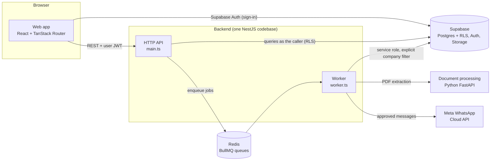

# LeaseGuard

**Commercial lease monitoring and tenant communication for property managers.**

LeaseGuard works alongside a client's existing accounting software. Property managers upload the PDF
statements their accounting system already produces. LeaseGuard extracts the figures, checks them against
the verified lease terms, and flags what needs attention: incorrect rental escalations, approaching lease
expiries and renewal deadlines, expiring or insufficient bank guarantees, and tenant arrears. Approved
statements and payment reminders go to tenants through each client company's own WhatsApp Business number.

Built for **Nexus Solution**. The product scope is defined in the
[MVP Product Requirements Document](docs/LeaseGuard%20MVP%20v1.0.pdf) (v1.0, 31 October 2026).

> [!IMPORTANT]
> **LeaseGuard is a monitoring and communication platform only.** It never collects, processes, holds or
> facilitates payments. It has no payment gateway, banking integration or transaction processing. Statement
> balances and payment arrangements are monitoring records, not transactions. Tenants keep paying landlords
> through their existing channels.

---

## Contents

- [What LeaseGuard does](#what-leaseguard-does)
- [Business rules](#business-rules)
- [Architecture](#architecture)
- [Technology stack](#technology-stack)
- [Repository structure](#repository-structure)
- [Getting started](#getting-started)
- [Commands](#commands)
- [Configuration](#configuration)
- [Testing](#testing)
- [Security model](#security-model)
- [Project status](#project-status)
- [Documentation](#documentation)
- [Contributing](#contributing)

---

## What LeaseGuard does

### Who uses it

| User | How they use LeaseGuard |
| --- | --- |
| **Property manager** | The main web-app user. Manages properties, units, tenants and leases; uploads and reviews statements; works through monitoring events; records payment arrangements; approves every tenant message. |
| **Property owner** | Receives portfolio updates through WhatsApp and does not need to log in for routine reporting. |
| **Tenant** | Receives statements and payment reminders through WhatsApp, and nothing else. |

Several client companies share the platform. Each sees only its own data and sends messages from its
own approved WhatsApp Business number.

### Statement processing

1. A property manager uploads a PDF statement from MRI, MDA, PropSys, Sage or another system that produces PDFs.
2. The original PDF is stored securely and stays available for reference.
3. The document-processing service extracts tenant, unit, statement period, rental and additional charges,
   payments, outstanding balance and total due. It reads the text layer first and falls back to OCR for
   scanned documents.
4. Values that are uncertain, missing or don't reconcile are **flagged, never guessed**.
5. The property manager reviews and confirms the figures. Only verified figures reach the monitoring engine.
6. Duplicate uploads are detected: an identical file is rejected, and a likely duplicate produces a warning.

### Monitoring engine

The engine runs on a schedule and applies deterministic, explainable rules to **verified** lease terms and
statements:

| Monitor | What it detects |
| --- | --- |
| Rental escalation | Billed rental against the expected escalated rental. For example, R35 000 + 8 % = R37 800 expected, R35 000 billed: R2 800 discrepancy. |
| Lease expiry | Leases approaching expiry, using configurable advance-notice intervals. |
| Renewal options | Notice deadlines for exercising renewal options. |
| Deposits and guarantees | Guarantees approaching expiry, and coverage shortfalls after escalations. |
| Arrears | Outstanding balances, aged by bucket, based on verified statements only. |
| Payment arrangements | Missed instalments and arrangements that need attention. An active arrangement pauses normal arrears reminders. |

Each finding becomes a **monitoring event** with a priority, a recommended action, an assigned property
manager and a status: New, Under review, Action required, In progress, Resolved or Dismissed (with a reason).

### WhatsApp communication

LeaseGuard uses the official **Meta WhatsApp Business Platform Cloud API**, never unofficial WhatsApp Web automation.
Every client company has its own WhatsApp Business configuration. The sender is always chosen from the company
that owns the tenant or property.

---

## Business rules

These rules are enforced in code, in the database, and in tests. Treat them as non-negotiable.

- **No payments.** No payment collection, processing, gateways, banking APIs or transfers.
- **Company isolation.** Every company-owned record carries `company_id`. Postgres Row Level Security
  enforces isolation; the frontend's workspace scoping is a convenience, not a security boundary.
- **Tenants receive only statement and payment-related messages:** monthly statements, initial, overdue
  and follow-up payment reminders, and arrangement instalment reminders. Tenants **never** receive automated
  messages about escalations, lease expiry, renewal options, disputes or guarantees.
- **Every tenant message needs property-manager approval** before it is sent.
- **No bank details in message text.** Bank details may appear only in the original statement attachment.
- **Lease terms must be verified** by an authorised person before they drive financial monitoring.
- **Statements are never silently guessed.** Uncertain extraction is flagged for human review.
- **South African conventions.** Currency is ZAR throughout; dates use `en-ZA` (`dd MMM yyyy`).

---

## Architecture

LeaseGuard is a **modular monolith** with a separate document-processing service and a background worker.



| Component | Responsibility |
| --- | --- |
| **Frontend** (`frontend/`) | Web application for property managers. It runs in **demo mode** (seeded data in the browser, no backend) or **API mode** (Supabase sign-in and the backend API). |
| **API** (`backend/src/main.ts`) | Authentication, company-level authorisation, validation, business operations and the OpenAPI document. Every database query runs as the signed-in user, so Row Level Security applies. |
| **Worker** (`backend/src/worker.ts`) | Scheduled monitoring, statement processing and WhatsApp delivery, with retries, idempotency and job-run tracking. It is the only process that holds the Supabase service-role key. |
| **Document processing** (`python-services/document-processing/`) | Stateless PDF text and OCR extraction, parsing and validation. It returns a structured, confidence-scored proposal; it never decides on its own. |
| **Domain package** (`packages/domain/`) | The single source of business rules (escalations, expiry, renewal deadlines, guarantee coverage, arrears ageing, arrangement suppression, duplicate detection, communication eligibility) and the extraction wire contract. Framework-free and fully unit tested. |
| **API client** (`packages/api-client/`) | A typed client generated from the backend's OpenAPI document, so request and response types are never written by hand twice. |
| **Database** (`supabase/`) | Versioned migrations, Row Level Security policies, audit triggers, storage policies, database tests and the local seed. |

> The PRD suggested Next.js for both the frontend and the backend. This implementation keeps the same
> layers but uses a Vite single-page app and a NestJS modular monolith, so the API and the worker share
> one typed codebase.

---

## Technology stack

| Area | Technology |
| --- | --- |
| Frontend | React 19, TypeScript (strict), Vite, TanStack Router (file-based routes), TanStack Query, Zustand, Tailwind CSS v4, shadcn/ui, Lucide icons, React Hook Form, Zod, date-fns |
| Backend | NestJS 11 (HTTP API and worker), Zod validation, Swagger/OpenAPI, pino structured logging, helmet |
| Database, auth, storage | Supabase: PostgreSQL with Row Level Security, Supabase Auth, Supabase Storage |
| Background jobs | Redis + BullMQ: scheduled jobs, retries with backoff, deterministic job ids |
| Document processing | Python 3.14, FastAPI, Pydantic, PyMuPDF, pdfplumber, Tesseract OCR |
| Messaging | Meta WhatsApp Business Platform Cloud API |
| Tooling | pnpm workspaces, TypeScript 7, oxlint, Vitest, Testing Library, Playwright, pytest, ruff, pgTAP, Docker |

---

## Repository structure

```text
LeaseGuard/
├── frontend/                     React web application
│   └── src/
│       ├── app/                  router, file routes, layouts, providers
│       ├── features/             feature modules (properties, leases, statements, …)
│       ├── components/           ui (shadcn), shared, layout, forms
│       ├── services/api/         API boundary: config, Supabase auth, API client, query client
│       ├── services/demo/        browser-only demo data source (localStorage), isolated from API mode
│       ├── store/  lib/  styles/  test/
├── backend/                      NestJS modular monolith (API + worker)
│   └── src/
│       ├── modules/              business modules: auth, users, companies, properties, units,
│       │                         tenants, leases, statements, monitoring, arrangements,
│       │                         communications, notifications, audit
│       ├── infrastructure/       database, storage, queues, document-processing, whatsapp, health
│       ├── workers/              queues, processors, schedulers, jobs
│       ├── common/               guards, decorators, filters, pipes, logging
│       ├── config/               validated environment configuration
│       ├── main.ts               HTTP API entry point
│       └── worker.ts             background worker entry point
├── python-services/
│   └── document-processing/      FastAPI extraction service (app/, tests/, scripts/, Dockerfile)
├── packages/
│   ├── domain/                   @leaseguard/domain: types and pure business rules
│   └── api-client/               @leaseguard/api-client: generated, typed API client
├── supabase/                     migrations/, tests/ (pgTAP), seed.sql, config.toml
├── infrastructure/               docker/, deployment/, scripts/
├── tests/                        cross-service integration and end-to-end tests
├── docs/                         PRD, architecture, development notes
├── docker-compose.yml            local Redis, API, worker and document-processing containers
└── .env.example                  the single environment contract for every process
```

---

## Getting started

### Prerequisites

- **Node.js 24+** and **pnpm 12** (`corepack enable` picks up the pinned version)
- **Docker** (Docker Desktop, Colima or similar), used by the Supabase CLI and for Redis
- **Python 3.14** for the document-processing service
- **Tesseract OCR** for local OCR fallback (for example `brew install tesseract`); the container image includes it

### Quick look: demo mode (frontend only)

Demo mode runs the whole web app in the browser on seeded South African demo data. No backend, database or
credentials are needed.

```bash
pnpm install
cp .env.example .env          # VITE_DATA_SOURCE=demo is the default
pnpm dev:frontend             # http://localhost:5173
```

### Full local stack

```bash
pnpm install
cp .env.example .env

# 1. Database, auth and storage (local Supabase; applies migrations and the local seed)
pnpm db:start
pnpm db:status                # copy the anon key to SUPABASE_ANON_KEY and VITE_SUPABASE_ANON_KEY,
                              # and the service-role key to SUPABASE_SERVICE_ROLE_KEY in .env

# 2. Redis for background jobs
pnpm docker:up redis

# 3. Document-processing service
pnpm python:setup             # creates python-services/document-processing/.venv
pnpm dev:python               # http://127.0.0.1:8000

# 4. Web app, API and worker (in parallel)
pnpm dev                      # web http://localhost:5173 · API http://127.0.0.1:3000 · docs /api/docs
```

To use the real API from the web app, set `VITE_DATA_SOURCE=api` in `.env` and sign in with a seeded
user. Every local demo user's password is `leaseguard-local-only`. **These credentials exist only in the
local seed: never load `supabase/seed.sql` into a shared or production project.**

The whole backend can also run in containers with `pnpm docker:up` (API, worker, document processing and
Redis; Supabase still runs through its CLI).

---

## Commands

All commands run from the repository root.

| Command | Purpose |
| --- | --- |
| `pnpm dev` | Web app, API and worker together, with reload |
| `pnpm dev:frontend` · `dev:backend` · `dev:worker` · `dev:python` | Run one process |
| `pnpm build` | Build every package in dependency order |
| `pnpm typecheck` · `pnpm lint` | Type-check and lint every package |
| `pnpm test` | Unit tests for domain, API client, backend and frontend |
| `pnpm test:domain` · `test:api-client` · `test:backend` · `test:frontend` | Unit tests for one package |
| `pnpm test:integration` | API integration tests against local Supabase and Redis |
| `pnpm test:e2e` | Playwright end-to-end tests |
| `pnpm db:start` · `db:stop` · `db:status` | Local Supabase stack |
| `pnpm db:reset` | Recreate the local database from migrations and the seed |
| `pnpm db:test` | Database tests (pgTAP): RLS isolation, audit and business-rule constraints |
| `pnpm db:types` | Regenerate typed database definitions for the backend |
| `pnpm db:seed:generate` | Regenerate `supabase/seed.sql` from the frontend demo data |
| `pnpm api:generate` | Regenerate `backend/openapi.json` and the typed API client |
| `pnpm python:setup` · `python:test` · `python:lint` | Document-processing service |
| `pnpm docker:config` · `docker:up` · `docker:down` | Docker Compose for local development |

---

## Configuration

Every process reads **one** environment contract: [`.env.example`](.env.example), copied to `.env` at the
repository root. Each process validates its variables at startup and refuses to start with a clear message
if any are missing or invalid:

| Process | Validation |
| --- | --- |
| API and worker | Zod: `backend/src/config/env.ts` |
| Document processing | Pydantic: `python-services/document-processing/app/core/config.py` |
| Web app | Zod: `frontend/src/services/api/config.ts`. Only `VITE_*` variables reach the browser. |

- `SUPABASE_SERVICE_ROLE_KEY` is for the **worker only**. Each process loads only the variables its own
  schema declares, so the API never holds this key, and no service-role key is ever exposed to the browser.
- `VITE_SUPABASE_ANON_KEY` (the public anon or publishable key) is the only Supabase key the browser receives.
- WhatsApp access tokens are never stored in the database or in `.env.example`. Each company's
  `whatsapp_accounts.access_token_reference` points to a secret (`secret://env/<VARIABLE>`) that the worker
  resolves from its own environment.
- Never commit `.env`.

---

## Testing

| Layer | Tooling | Location |
| --- | --- | --- |
| Business rules | Vitest | `packages/domain/src/**/*.test.ts` |
| API client | Vitest | `packages/api-client/src/**/*.test.ts` |
| Backend services, guards, processors | Vitest | `backend/src/**/*.test.ts` |
| Web app components and data layer | Vitest + Testing Library | `frontend/src/**/*.test.ts(x)` |
| Document extraction and API contract | pytest | `python-services/document-processing/tests/` |
| Database isolation and constraints | pgTAP | `supabase/tests/` |
| API integration (API + Supabase + Redis) | Vitest | `tests/integration/` |
| End-to-end workflows | Playwright | `tests/e2e/` |

The Python test suite also checks that its extraction contract exactly matches the TypeScript contract in
`packages/domain`, so the two cannot drift apart.

---

## Security model

- **Authentication:** Supabase Auth. The API verifies every bearer token and accepts only signed-in user tokens.
- **Company authorisation:** company-scoped routes require an `X-Company-Id` header naming a company the
  caller belongs to; write operations are limited to company admins and property managers.
- **Row Level Security** on every company-owned table is the enforcing layer. API queries run with the
  caller's own token. The worker's service-role client always filters by company explicitly.
- **Protected storage:** private buckets for statements and lease documents, with per-company path policies.
- **Audit:** append-only audit log, with database triggers on lease verification, statement and extraction
  changes, monitoring events and message approvals.
- **Data protection:** LeaseGuard processes commercially sensitive information. Deployments must be reviewed
  against South African data-protection requirements, including **POPIA**.

---

## Project status

LeaseGuard is in active MVP development on the path to a single-property pilot.

| Area | Status |
| --- | --- |
| Multi-company database with RLS, audit triggers and storage policies | In place |
| Domain business rules (escalation, expiry, renewal, guarantees, arrears, arrangements, eligibility) | In place |
| Document-processing service (PDF text, OCR fallback, validation) | In place |
| Backend API modules, worker processors and scheduler | Foundations in place and being extended |
| Web app shell, navigation, workspace switching and demo mode | In place |
| Web app management screens | In progress: most screens are still placeholders |
| Statement review and correction workflow | Planned |
| WhatsApp webhooks, inbound replies, templates and opt-out handling | Planned |
| Weekly owner summaries and supported owner questions | Planned |
| CI/CD (GitHub Actions) and hosted deployment | Planned |

For what is out of scope for the MVP (payments, invoicing, VAT, native mobile apps, unrestricted chatbots and
more), see section 16 of the PRD.

---

## Documentation

- [MVP Product Requirements Document](docs/LeaseGuard%20MVP%20v1.0.pdf): product scope and acceptance criteria
- [docs/architecture/](docs/architecture/): architecture decisions, migration plan, frontend data layer
- [docs/development/](docs/development/): frontend component guide
- [python-services/document-processing/README.md](python-services/document-processing/README.md): extraction service
- [infrastructure/deployment/README.md](infrastructure/deployment/README.md): deployment notes
- API reference: Swagger UI at `/api/docs` when the API is running; the generated document is `backend/openapi.json`

---

## Contributing

- Use **pnpm** only; do not add other package managers or lockfiles.
- Business rules belong in `packages/domain`, never in UI components, controllers or the Python service.
- The frontend uses **TanStack Router file-based routing** under `frontend/src/app/router/routes`; do not add another router.
- Keep TypeScript strict, with no `any`. Validate input at every boundary.
- Every database change is a new, versioned migration in `supabase/migrations/`, with pgTAP tests where it
  touches security or integrity.
- Co-locate tests with the code (`*.test.ts`). Run `pnpm typecheck`, `pnpm lint` and `pnpm test` before opening a pull request.
- After changing backend endpoints, run `pnpm api:generate` and commit the updated OpenAPI document and client.

---

© Nexus Solution. Proprietary; no open-source licence is granted.
