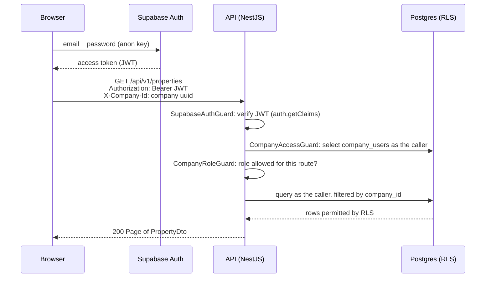

# Architecture overview

How the LeaseGuard processes fit together, how a request is authorised, how background jobs run, and
where the business rules live. Product scope is defined in the
[MVP PRD](../LeaseGuard%20MVP%20v1.0.pdf); this page describes the code as it is.

Related: [API conventions](../api/README.md) · [Database](../database/README.md) ·
[Security model](../security/README.md) · [Frontend data layer](frontend-data-layer.md).

## Processes

| Process | Code | Port (local) | Talks to |
| --- | --- | --- | --- |
| Web app | `frontend/` (Vite SPA) | 5173 (`pnpm dev:frontend`) | Supabase Auth (sign-in), the API. Nothing else in API mode; nothing at all in demo mode. |
| API | `backend/src/main.ts` | `API_PORT` (3000) | Supabase with the anon key plus the caller's JWT; Redis (enqueue only). |
| Worker | `backend/src/worker.ts` | none (no HTTP) | Supabase with the service-role key; Redis; document processing; WhatsApp Cloud API. |
| Document processing | `python-services/document-processing/` (FastAPI) | 8000 | Nothing. Stateless; called only by the worker. |
| Supabase | `supabase/` (local stack via the Supabase CLI) | 54321 (API), 54322 (Postgres) | Postgres with RLS, Auth, Storage. |
| Redis | `redis:7.4.12` in `docker-compose.yml`, or any local Redis | 6379 | BullMQ queues, keys under `QUEUE_PREFIX`. |
| WhatsApp Cloud API | Meta Graph API (`WHATSAPP_GRAPH_API_URL`, `WHATSAPP_GRAPH_API_VERSION`) | external | Called by the worker only. |

The API and the worker are built from one NestJS codebase and one image (`backend/Dockerfile`) but run
as separate processes: the API never consumes jobs and never holds the service-role key; the worker
serves no HTTP. Deployment details are in `infrastructure/deployment/README.md`.

The web app runs in one of two modes, fixed per build by `VITE_DATA_SOURCE`:

- `demo` (default): all data lives in the browser (seeded demo data in `localStorage`); no backend.
- `api`: Supabase sign-in, then every record comes from the API.

## Request flow (API mode)

1. **Authentication.** `SupabaseAuthGuard` (`backend/src/common/guards/supabase-auth.guard.ts`) is a
   global guard. It requires `Authorization: Bearer <token>`, verifies it with supabase-js
   `auth.getClaims`, and accepts only tokens with `role = authenticated` and a subject, so the anon and
   service-role keys are refused. It then creates one database client per request from the anon key
   plus the caller's token (`RlsClientFactory.forAccessToken`). Routes opt out only with `@Public()`
   (the health probes).
2. **Company scoping.** Routes decorated with `@CompanyScoped()` run `CompanyAccessGuard`: the
   `X-Company-Id` header must be a UUID (otherwise 400) naming a company where the caller has a
   `company_users` row, read through the caller's own client (otherwise 403).
3. **Role check.** `CompanyRoleGuard` enforces `@CompanyScoped({ roles })`; write routes use
   `WRITER_ROLES` (`company_admin`, `property_manager`).
4. **Query.** Handlers receive the caller's client with `@UserDb()` and also filter by `company_id`.
   Row Level Security is the enforcing layer; the guards give early, clear errors.
5. **Errors.** `AllExceptionsFilter` returns `{ statusCode, error, message, requestId }`. Database
   errors are translated by `httpErrorFromDatabase` (`backend/src/common/http/database-errors.ts`)
   without leaking constraint or policy names.

The generated client (`@leaseguard/api-client`) adds the bearer token and `X-Company-Id` on every
request; the frontend's feature sources also pass the company id from their query key explicitly.

## Background jobs

Queues are declared in `backend/src/infrastructure/queues/queue-registry.ts`. Payloads carry ids
only; processors reload current rows themselves. The one exception is `whatsapp-webhook`, which carries Meta's
signed raw payload (the API cannot store it; the worker stores it first and the job is removed once completed).

| Queue | Payload | Enqueued by | Concurrency |
| --- | --- | --- | --- |
| `statement-processing` | `companyId`, `statementId` | API: `POST /statements`, `POST /statements/{id}/process` | 2 |
| `message-delivery` | `companyId`, `communicationId` | API: `POST /communications/{id}/approve` | 4 |
| `monitoring-dispatch` | `asOf?` | BullMQ job scheduler `daily-monitoring-dispatch`, `0 6 * * *` Africa/Johannesburg | 1 |
| `lease-monitoring` | `companyId`, `asOf` | `monitoring-dispatch`, one job per active company | 1 |
| `arrears-monitoring` | `companyId`, `asOf` | `monitoring-dispatch` | 1 |
| `arrangement-reminders` | `companyId`, `asOf` | `monitoring-dispatch` | 1 |
| `whatsapp-webhook` | `payloadSha256`, `body`, `receivedAt` | API: `POST /webhooks/whatsapp` (Meta, signed) | 4 |

Processors live under `backend/src/workers/` (`statements/`, `messaging/`, `monitoring/`,
`scheduling/`). Reliability is layered:

- **Retries.** `DEFAULT_JOB_OPTIONS`: 5 attempts, exponential backoff from 30 s. Errors that retrying
  cannot fix are thrown as BullMQ `UnrecoverableError` (for example `UndeliverableMessageError`) and
  fail immediately.
- **Deterministic job ids.** `jobIdFor` builds `<queue>.<key fields>` (for example
  `message-delivery.<companyId>.<communicationId>`), so enqueueing the same unit of work twice yields
  one job. The scheduler registration is an idempotent upsert, so every worker replica may register it.
- **Processed markers.** `createIdempotentWorker` (`backend/src/workers/jobs/idempotent-worker.ts`)
  skips a job id that already completed, using a Redis key `<prefix>:processed:<queue>:<jobId>` kept
  for 30 days. The marker is written after success, so delivery is at-least-once and processors must
  be safe to repeat.
- **Database dedupe keys.** Monitoring jobs write `monitoring_events` and `notifications` with a
  deterministic `dedupe_key` and `ON CONFLICT (company_id, dedupe_key) DO NOTHING`
  (`backend/src/workers/shared/monitoring-outputs.ts`). A trigger stops signed-in users from setting or
  changing a key (see [Database](../database/README.md#worker-tables-and-columns)).
- **Message delivery.** A message that already has an external id or a sent status is skipped; after
  a successful send the job never retries, so a recipient is not messaged twice.
- **Communication lifecycle.** One deep module owns every status transition of a communication and
  the "may already have been sent" knowledge: `backend/src/messaging/communication-lifecycle.ts`.
  Its interface is one function per transition (`decide`, `claim`, `release`, `recordSent`,
  `recordFailed`, `recordProviderStatus`) and questions about a loaded message (`deliveryState`,
  `mayHaveBeenSent`, `mayRetryDelivery`), so callers branch on the module's answer rather than on
  status literals; its implementation is one SQL function per transition plus a transition table the
  database enforces for signed-in users and the service role alike, and for the service role the
  database accepts delivery-state writes only from inside those functions
  (`20261110100300_communication_lifecycle.sql`). The approve/reject endpoints, the delivery worker
  and, next, the WhatsApp webhook (status callbacks) call it; none of them writes
  `communications.status`. "May have been sent" is the recorded fact
  `communications.send_uncertain_since`: set by the claim immediately before a send and cleared only
  when the outcome is known, so a crash after the send still leaves the message protected. A claim
  is owned: `claim` returns a `SendClaim` to its one winner, and only that holder can release it or
  record that its send did not happen; a second run of the same job that fails before its own claim
  can never clear the first run's fact while that send is in flight. Provider
  status callbacks are monotonic and safe out of order (each fills its own timestamp once; the status
  only moves forward along sent, delivered, read; a callback for a message id not recorded yet is
  answered `not_found` for the caller to retry). The transitions are tested against local Postgres:
  rule by rule in `supabase/tests/communication_lifecycle.test.sql`, and through the module's
  interface in `tests/integration/communication-lifecycle.test.ts`.
- **Outbound gate.** Approve and deliver ask one module, `checkOutbound` in
  `backend/src/messaging/outbound-gate.ts`: "is this message deliverable, and if not, why not". It
  loads the message, its governing approval, the recipient, arrangements, template and channel
  readiness once, applies the domain rules, and returns either what the deliverer needs next or every
  blocker. The approve endpoint asks as if its approval were granted (blockers are a 422), the worker
  asks immediately before claiming (blockers fail the message without retry), so nothing is approved
  that delivery would refuse. `backend/src/messaging/` is shared by `modules/` and `workers/` (the
  communication lifecycle, the governing-approval rule, the arrangement read used by arrears
  monitoring, and the WhatsApp message builder live there); the one "today in South Africa" is
  `backend/src/common/sa-today.ts`.
- **Dependency direction.** `modules/` (the API) and `workers/` never import each other; what both
  need lives in `messaging/`, `infrastructure/` (for example the lease row adapter,
  `infrastructure/database/lease-rows.ts`) or `common/`, and those import neither. Keeping the two
  callers apart gives each shared module one seam and keeps changes local.
  `backend/src/architecture.test.ts` fails on any import that breaks this, test files included.
- **Job history.** Every finished attempt is written to `job_runs` (`succeeded`, `skipped` or
  `failed`, with `will_retry`) by `JobRunRecorderService`. A failed row with `will_retry = false` is a
  dead letter. Recording failures are logged and never fail the job.
- **Company filter.** The service-role client bypasses RLS, so every worker query filters by
  `company_id` explicitly. `monitoring-dispatch` is the only payload without a company.

Lease monitoring reads only verified leases (`verified = true`); lease and arrears monitoring use only
verified statements (`status = 'verified'`).

## Where business rules live

`packages/domain` (`@leaseguard/domain`) is the single source of business rules. It has no framework
imports, no I/O and no clock reads; date-sensitive functions take `today` explicitly.

| Module (`packages/domain/src/rules/`) | Rule |
| --- | --- |
| `money.ts`, `dates.ts` | ZAR rounding and formatting (`formatZAR`), South African date formatting (`formatSADate`) |
| `escalation.ts` | Expected escalated rental and discrepancies |
| `leaseExpiry.ts`, `renewalNotice.ts` | Expiry thresholds and renewal notice deadlines |
| `guarantee.ts` | Guarantee expiry and coverage shortfalls |
| `arrears.ts`, `arrangements.ts` | Arrears ageing; arrangement suppression of arrears reminders |
| `statementDuplicates.ts` | Identical-file and likely-duplicate statement detection |
| `extractionReview.ts` | Assessment of an extraction proposal for review |
| `monitoringWorkflow.ts` | Allowed monitoring event status transitions |
| `communicationEligibility.ts`, `messageContent.ts` | Who may receive which message type; banking details and forbidden tenant topics in message text |

Who executes them:

- **Backend (authoritative).** The worker runs the monitoring and extraction rules. The API runs
  duplicate detection, monitoring status transitions and, on approval, the same outbound gate the
  worker applies before sending (`backend/src/messaging/outbound-gate.ts`).
- **Frontend demo mode** reuses the same functions so the demo behaves like the backend.
- **Python** only extracts and validates; it decides nothing.
- **Database** constraints and triggers are the last line of defence (tenant message types, the
  tenant approval guard, verified leases for financial events, cross-company foreign keys,
  append-only audit log). See [Database](../database/README.md).

One owner per tenant-messaging rule: `@leaseguard/domain` owns the tenant message types
(`TENANT_MESSAGE_TYPES`) and "tenant messages always need approval" (`canSendTenantMessage`, no
company setting). The database mirrors both (`private.is_tenant_message_type`, the
`tenant_message_requires_approval` guard), and the copies are checked, not assumed: the tenant message
type list is compared with the SQL predicate through `supabase/tests/tenant_message_rules.test.sql`
and `backend/src/infrastructure/database/enum-parity.test.ts`.

The backend loads the domain package from its compiled `dist` (built automatically by
`backend/scripts/domain-build.mjs`); the frontend and tests compile its TypeScript source through the
`@leaseguard/source` export condition.

## Extraction contract

The worker sends each statement PDF to `POST /v1/extractions` on the document-processing service
(multipart: the file plus `companyId`, `statementId`, `sourceSystem` and optional repeated
`expectedTenantNames` / `expectedUnitNumbers`), authenticated with `DOCUMENT_PROCESSING_TOKEN` as a
bearer token.

- **Source of truth:** `packages/domain/src/types/extraction.ts` (`DocumentExtractionResult`,
  fields, line items, issues, error codes) with the enums in `packages/domain/src/types/statement.ts`.
- **Python mirror:** `python-services/document-processing/app/schemas/v1.py`. Python attributes are
  snake_case; the JSON wire format is camelCase with the TypeScript names, and nullable properties
  are always present.
- **Money** travels as `ZarDecimal`: a string with exactly two decimals (`"35000.00"`), read with
  `parseZarDecimal`.
- **Drift checks:** `python-services/document-processing/tests/test_project_consistency.py` parses
  the TypeScript files and fails on any difference. The backend validates every response at run time
  with zod (`backend/src/infrastructure/document-processing/document-processing.schemas.ts`) and
  rejects responses that break the contract.
- **Outcome:** the result is a proposal. The worker stores it as a `statement_extractions` row with
  status `pending_review` plus one `statement_extraction_fields` row per field, and sets the statement
  to `review_required`. If extraction fails permanently, the statement is still `review_required`, with
  `processing_error` set, for manual entry. Nothing is guessed.

When the contract changes: change the TypeScript first, then the Python schema, then regenerate the
service's `openapi.json` (`python-services/document-processing/scripts/export_openapi.py`).
