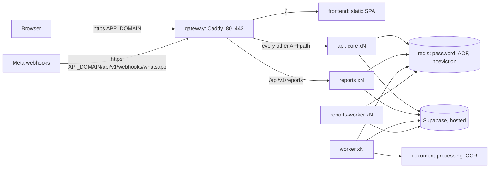

# Production runbook

LeaseGuard in production runs on **one Docker host** from versioned images in GitHub Container Registry (GHCR).
Supabase (database, auth, storage) stays hosted (project `ilplapsqrbcviqlhnzov`). Any server that runs Docker
works; nothing here is tied to a cloud vendor (owner decision, 21 Nov 2026).

| Piece | Where |
| --- | --- |
| Production compose file | `infrastructure/deployment/production/compose.yml` |
| Shared settings (domains, images, shared secrets) | `infrastructure/deployment/production/.env.example` → `.env` |
| Each service's own settings | `infrastructure/deployment/production/env/<service>.env.example` → `env/<service>.env` |
| Deploy / update / rollback | `infrastructure/deployment/production/deploy.sh <tag>` |
| Gateway (Caddy, automatic HTTPS) | `infrastructure/gateway/caddy/` (routes from `infrastructure/gateway/routes.json`) |
| CI, images, optional deploy | `.github/workflows/ci.yml` |
| Migrations (manual, approved) | `.github/workflows/migrations.yml` |
| Local proof of the whole stack | `pnpm docker:production-proof` (`infrastructure/scripts/production-proof.sh`) |
| Process-level reference (variables, health, caching, secrets) | `infrastructure/deployment/README.md` |

LeaseGuard is monitoring and communication only: nothing here collects, processes or holds payments.

## What runs



- Only the gateway publishes ports (80, 443). Redis, the services and the workers are reachable only on the compose
  network.
- **One setting set drives every URL.** `APP_DOMAIN` and `API_DOMAIN` in `.env`: the gateway's certificates, the
  API's and reports' CORS origin (`https://APP_DOMAIN`), the invitation links (`WEB_APP_URL=https://APP_DOMAIN`) and
  the webhook address all follow them. The web app's bundle reads the same names from the GitHub repository variables
  (it is compiled, so it is built by CI; see "Switching to a real domain").
- **Startup validation.** With `NODE_ENV=production` (set by `compose.yml`) the API, worker, reports service and
  reports worker refuse to start on a plain-http or loopback URL, a loopback CORS origin, a missing anon or
  service-role key, Redis without a password, or a document-processing token under 32 characters. The message names
  every problem, never a value. The gateway refuses to start without `APP_DOMAIN`, `API_DOMAIN` and `GATEWAY_TLS`.
- **The gateway** (Caddy) routes by path from `infrastructure/gateway/routes.json`, the table the Vite dev proxy
  uses: the image renders its Caddyfile from that file at build, so development and production cannot drift. It
  passes request bodies through unchanged (the webhook signature covers the exact bytes), allows 4 MB bodies, never
  caches, retries another replica only when no connection could be made or for a GET, skips a replica that refuses
  connections for 10 s (passive checks: Caddy runs no active checks on DNS-discovered replicas), keeps idle upstream
  connections for 60 s (under the services' 65 s) and removes the webhook's
  verify token from its access log. It adds HSTS. API paths also answer on `APP_DOMAIN`.

## 1. First run without a domain (sslip.io)

LeaseGuard has no domain yet. Use the server's public IPv4 address with **sslip.io**, a public DNS service that
answers `<anything>.<ip>.sslip.io` with `<ip>`. No DNS records are needed, and Caddy gets real Let's Encrypt
certificates for these names, so the WhatsApp webhook has a permanent, valid HTTPS address that Meta accepts.

With the server at `203.0.113.10` (replace with yours):

| Setting | Value |
| --- | --- |
| `APP_DOMAIN` | `app.203.0.113.10.sslip.io` |
| `API_DOMAIN` | `api.203.0.113.10.sslip.io` |
| Web app | `https://app.203.0.113.10.sslip.io` |
| WhatsApp webhook (callback URL) | `https://api.203.0.113.10.sslip.io/api/v1/webhooks/whatsapp` |

`nip.io` works the same way (`app.203.0.113.10.nip.io`); dashes instead of dots also work
(`app.203-0-113-10.sslip.io`).

**Trade-offs**

- The address **is the IP**. If the server's IP changes (a new server, or a provider that does not keep the IP),
  every URL changes: the Meta callback URL, the Supabase Auth URLs, the GitHub variables and the frontend build. Ask
  the provider for a static (reserved) IP.
- sslip.io is a free third-party service. If its DNS is down, new visitors and Meta cannot resolve the hosts.
  Let's Encrypt also limits certificates per registered domain (50 a week for all of `sslip.io`'s users together);
  Caddy keeps its certificates in the `gateway-data` volume, so this only matters if that volume is lost.
- **Move to a real domain before onboarding client businesses.** Client-facing links, invitation emails and Meta's
  Business Verification and App Review all look for a domain the business owns.
- **Meta Embedded Signup.** Meta's Embedded Signup documentation asks for every domain hosting the flow in Facebook
  Login for Business > Settings > Client OAuth settings ("Allowed domains" and "Valid OAuth redirect URIs"), with
  Enforce HTTPS on, and states one restriction: the domain must serve HTTPS with a valid certificate. An sslip.io
  host meets that (Let's Encrypt), and `sslip.io` is not on the Public Suffix List, so Meta sees a normal host name.
  Nothing in Meta's documentation forbids it, but it is **not verified** in LeaseGuard's App Dashboard yet: enter
  `https://app.<ip>.sslip.io/` there and confirm the dashboard accepts it (and the app's App Domains field, which
  community reports say the JavaScript SDK also checks). Expect a real domain to be needed anyway for App Review
  (privacy policy and website URLs on the business's own domain).

## 2. Server setup

Any Linux server with a public static IPv4 address; 2 vCPU and 4 GB RAM is enough for the pilot (the default
resource limits in `compose.yml` add up to about 4.7 GB, but they are limits, not reservations).

```sh
# Docker Engine and the compose plugin (Ubuntu/Debian; see docs.docker.com/engine/install)
curl -fsSL https://get.docker.com | sh
sudo usermod -aG docker "$USER"      # log out and in again

# Firewall: only SSH, 80 (Let's Encrypt and the redirect to https) and 443 (also UDP for HTTP/3)
sudo ufw default deny incoming
sudo ufw allow OpenSSH
sudo ufw allow 80/tcp
sudo ufw allow 443/tcp
sudo ufw allow 443/udp
sudo ufw enable
```

Docker publishes ports past `ufw` rules, so keep every service except the gateway unpublished (as `compose.yml`
does) and do not add `ports:` to other services. If the provider has its own firewall, open the same ports there.

## 3. DNS records

- **sslip.io (first run):** none.
- **Real domain:** two `A` records to the server's IPv4 address, for example `app.leaseguard.co.za` and
  `api.leaseguard.co.za` (and `AAAA` records if the server has IPv6 and port 80/443 are open on it). Keep the TTL
  low (300 s) for the first weeks. The email sender's domain also needs the SPF and DKIM records the SMTP provider
  (Resend) gives you.

## 4. GitHub setup (images and the optional deploy)

Repository Settings > Secrets and variables > Actions:

| Kind | Name | Value |
| --- | --- | --- |
| Variable | `APP_DOMAIN` | as in the server's `.env` |
| Variable | `API_DOMAIN` | as in the server's `.env` (the web app calls `https://API_DOMAIN`) |
| Variable | `SUPABASE_URL` | `https://ilplapsqrbcviqlhnzov.supabase.co` |
| Variable | `SUPABASE_ANON_KEY` | the public anon key (compiled into the web app; never the service-role key) |
| Variable | `DEPLOY_PATH` | optional, default `/opt/leaseguard` |
| Secret | `DEPLOY_HOST`, `DEPLOY_USER` | the server and an SSH user in the `docker` group |
| Secret | `DEPLOY_SSH_KEY` | a private key used only for deploys (its public key in that user's `authorized_keys`) |
| Secret | `DEPLOY_KNOWN_HOSTS` | the output of `ssh-keyscan -t ed25519 <server>` (checked; no trust on first use) |
| Environment secret (`production-database`) | `SUPABASE_DB_PASSWORD`, `SUPABASE_DB_POOLER_URL` | for the migrations workflow (session pooler: GitHub's runners have no IPv6) |

Environments (Settings > Environments): create `production` (the deploy job) and `production-database`
(migrations), and give both **required reviewers**, so every deploy and every migration waits for an approval.

What CI does (`.github/workflows/ci.yml`):

- every push and pull request: install, typecheck, lint and unit tests (Node workspace), ruff and pytest (Python);
- pushes to `develop` and `main`: build all five images and push them to
  `ghcr.io/<owner>/leaseguard-{gateway,frontend,backend,reports,document-processing}`, tagged with the full commit
  SHA and the branch name. Without `API_DOMAIN` the frontend image is skipped with a warning;
- pushes to `main`, when all four `DEPLOY_*` secrets exist: SSH to the server and run `./deploy.sh <commit sha>`.
  Without them the job is skipped (a notice, not a failure).

GHCR packages are private by default. On the server, log in once with a personal access token (classic) that has
only `read:packages`: `echo <token> | docker login ghcr.io -u <github user> --password-stdin`. Or make the five
packages public (they hold no secrets: every image is built without `.env` files).

## 5. First deploy

On the server:

```sh
sudo mkdir -p /opt/leaseguard && sudo chown "$USER" /opt/leaseguard
# Copy infrastructure/deployment/production/ from the repository (git clone, or scp the directory):
scp -r infrastructure/deployment/production/. <user>@<server>:/opt/leaseguard/
cd /opt/leaseguard
cp .env.example .env
for f in env/*.env.example; do cp "$f" "${f%.example}"; done
chmod 600 .env env/*.env
```

Fill in `.env` (`openssl rand -hex 32` for each generated secret):

- `APP_DOMAIN`, `API_DOMAIN` (section 1), `IMAGE_REGISTRY=ghcr.io/<owner, lowercase>`, `IMAGE_TAG=<commit sha>`
  (from the CI run on `main`);
- `SUPABASE_ANON_KEY`, `SUPABASE_SERVICE_ROLE_KEY` (Dashboard > Project Settings > API);
- `REDIS_PASSWORD`, `DOCUMENT_PROCESSING_TOKEN` (generated);
- `WHATSAPP_APP_ID`, `WHATSAPP_APP_SECRET` (Meta App Dashboard > App settings > Basic).

Then `env/gateway.env` (`GATEWAY_TLS=<ops email address>`), `env/api.env` (`WHATSAPP_WEBHOOK_VERIFY_TOKEN`
generated, `WHATSAPP_EMBEDDED_SIGNUP_CONFIG_ID`, optional `GOOGLE_MAPS_API_KEY`) and `env/worker.env` (optional
`ANTHROPIC_API_KEY`, any `WHATSAPP_ACCESS_TOKEN_<COMPANY ID>`).

Apply the database migrations first (section 9), then:

```sh
./deploy.sh <commit sha>
curl -fsS https://<API_DOMAIN>/health/ready     # {"status":"ready",...}
curl -fsS https://<API_DOMAIN>/healthz          # ok (the gateway)
curl -fsSI https://<APP_DOMAIN>/                # 200, the web app
```

The first request for each host name takes a few seconds while Caddy obtains its certificate. If it fails, check
`docker compose logs gateway` (port 80 must reach the server for Let's Encrypt's HTTP challenge).

## 6. Meta webhook and Embedded Signup

In the Meta App Dashboard of LeaseGuard's app:

1. **WhatsApp > Configuration > Webhook**: Callback URL `https://<API_DOMAIN>/api/v1/webhooks/whatsapp`, Verify token
   = `WHATSAPP_WEBHOOK_VERIFY_TOKEN` from `env/api.env`, then **Verify and save**. Meta calls the handshake; the API
   answers with the challenge (403 on a wrong token, 503 if the token is not set).
2. **Webhook fields**: subscribe to `messages` (also `account_update`, `message_template_status_update` and
   `phone_number_quality_update`, which LeaseGuard also processes; see `docs/integrations/whatsapp.md`).
3. **Facebook Login for Business > Settings > Client OAuth settings**: Login with the JavaScript SDK, Web OAuth login,
   Enforce HTTPS and Strict Mode on; add `https://<APP_DOMAIN>/` to **Allowed domains for the JavaScript SDK** and
   **Valid OAuth redirect URIs**. Add `<APP_DOMAIN>` to **App settings > Basic > App Domains**. (sslip.io caveat in
   section 1.)
4. Check in LeaseGuard: Settings > Integrations > WhatsApp lists nothing missing, or call
   `GET /api/v1/integrations/whatsapp/capabilities` signed in.

The webhook path keeps the raw body through the gateway; Meta's `X-Hub-Signature-256` is checked by the API with
`WHATSAPP_APP_SECRET`.

## 7. Supabase Auth URLs and email (SMTP)

From a machine with the repository (not the server), with the hosted project's values in the environment or in
`backend/.env` (`SUPABASE_URL`, `SUPABASE_ACCESS_TOKEN`, `WEB_APP_URL=https://<APP_DOMAIN>`, and Resend's
`SMTP_HOST=smtp.resend.com`, `SMTP_PORT=587`, `SMTP_USER=resend`, `SMTP_PASS=<Resend API key>`,
`SMTP_SENDER_EMAIL`):

```sh
pnpm auth:configure:remote                 # dry run: shows what would change
pnpm auth:configure:remote -- --apply      # applies after confirmation
```

It sets the **Site URL** to `https://<APP_DOMAIN>` and adds the redirect allow-list entries
`https://<APP_DOMAIN>/auth/accept**` and `https://<APP_DOMAIN>/auth/reset-password**` (existing entries are kept),
custom SMTP, the email templates and invite-only sign-up. Check the result in Dashboard > Authentication > URL
Configuration. The sender's domain must be verified in Resend (SPF and DKIM).

## 8. Updates and rollback

- **Update**: a push to `main` builds the images and, with the deploy secrets, runs `./deploy.sh <sha>` on the
  server. By hand: `cd /opt/leaseguard && ./deploy.sh <sha>`.
- **Rollback**: `./deploy.sh <previous sha>` (the script prints the previous tag when it changes it). Old images stay
  on the server for this; `docker image prune -f` only removes untagged layers. A rollback never reverts a database
  migration: migrations are forward-only, so roll back code only to a version that works with the current schema.
- **Settings change** (an `.env` value): `docker compose up -d` recreates only the services whose settings changed.
- `docker compose ps` shows every service's health; `deploy.sh` waits up to 5 minutes for all to be healthy.

## 9. Migrations (manual, approved)

Never automatic. Actions > Migrations > Run workflow: `apply: false` lists the pending migrations, `apply: true`
applies them (after the `production-database` approval). Locally the same is `pnpm db:push:remote` (dry run) and
`pnpm db:push:remote -- --apply`. Apply migrations **before** deploying code that needs them.

## 10. Scaling, logs and health

- **Scale**: set `API_REPLICAS`, `WORKER_REPLICAS`, `REPORTS_REPLICAS`, `REPORTS_WORKER_REPLICAS` or
  `DOCUMENT_PROCESSING_REPLICAS` in `.env` and run `docker compose up -d`, or `docker compose up -d --scale api=3`.
  The gateway finds new replicas by DNS within 5 s and sends them traffic as soon as they accept connections, so a
  new API replica may answer `503` on `/health/ready` for its first seconds while it connects to Redis and Supabase. Workers
  scale freely (idempotent jobs). Before running a second API replica for real traffic, read "Load balancing the
  API" in `infrastructure/deployment/README.md` (no drain on shutdown yet; no idempotency keys on sending routes).
- **Resource limits**: per container in `compose.yml`, overridable with `<NAME>_CPUS` and `<NAME>_MEMORY` in `.env`.
- **Logs**: every process logs JSON lines to stdout; Docker keeps 5 × 10 MB per container (json-file rotation).
  `docker compose logs -f --tail 100 api worker`. Each API response has an `x-request-id` that appears in the logs.
- **Health**: `docker compose ps`. Through the gateway: `https://<API_DOMAIN>/healthz` (gateway),
  `/health` (core liveness), `/health/ready` (core readiness: Redis and Supabase). Containers: API and reports
  `/health`, document processing `/health/ready`, workers ping Redis, Redis `PING`, gateway and frontend `/healthz`.
  Every service restarts automatically (`unless-stopped`).

## 11. Backups

- **Database**: Supabase. On a paid plan turn on Point-in-Time Recovery (Dashboard > Database > Backups); otherwise
  take a daily logical dump from a trusted machine and keep it off the server:
  `pnpm exec supabase db dump --db-url "<session pooler URL with password>" -f leaseguard-$(date +%F).sql`
  (and `--data-only` for a data dump). Storage files (statements, lease documents) are not in database dumps; they
  stay in Supabase Storage.
- **Redis**: queues only, persisted with the append-only file in the `redis-data` volume (fsync every second). It
  holds no record that is not in the database; losing it loses queued jobs only. To keep a copy:
  `docker run --rm -v leaseguard_redis-data:/data -v "$PWD":/backup alpine tar czf /backup/redis-$(date +%F).tgz -C /data .`
- **Certificates**: the `gateway-data` volume; losing it means Caddy issues them again (mind the rate limits).
- **Settings**: keep a copy of `.env` and `env/*.env` in a password manager. They are not in git.

## 12. Switching to a real domain

Changing from sslip.io to, for example, `app.leaseguard.co.za` and `api.leaseguard.co.za` is exactly:

1. **DNS**: the two `A` records to the server (section 3). Wait until `dig +short app.leaseguard.co.za` answers.
2. **Server `.env`**: change `APP_DOMAIN` and `API_DOMAIN`, then `docker compose up -d`. Caddy obtains the new
   certificates; CORS, invitation links and the gateway follow.
3. **GitHub variables**: change `APP_DOMAIN` and `API_DOMAIN`, then re-run the CI workflow on `main` (or push) so the
   frontend image is rebuilt with the new API URL, and deploy that commit (`./deploy.sh <sha>`).
4. **Meta**: change the webhook Callback URL to `https://<new API_DOMAIN>/api/v1/webhooks/whatsapp` (same verify
   token; Verify and save), and add the new app domain to Allowed domains, Valid OAuth redirect URIs and App Domains
   (section 6). Remove the sslip.io entries once the new ones work.
5. **Supabase Auth**: `WEB_APP_URL=https://<new APP_DOMAIN>` and `pnpm auth:configure:remote -- --apply` (new Site
   URL and redirect entries); then remove the old sslip.io redirect entries in Dashboard > Authentication > URL
   Configuration.

Users signed in on the old address sign in again on the new one (browser storage is per origin).

## 13. Local proof

`pnpm docker:production-proof` builds every image and starts the production stack locally on the test domains
`app.leaseguard.test` and `api.leaseguard.test` with Caddy's internal CA, on 127.0.0.1:18080/18443, against the
local Supabase CLI stack (`pnpm db:start`) through a TLS front (`compose.proof.yml`). It checks health and readiness
through the gateway, the web app, the redirect to https, HSTS, CORS, the webhook handshake and a signed POST, path
routing to core and reports, the verify token's absence from the access log, a second API replica, and that
production refuses development values. It then removes every container, network, volume, image and file it created.
The workers get an invalid service-role key, so the proof never writes to the local database.

## 14. Go-live checklist

- [ ] Server: static IP, Docker, firewall with only 22, 80, 443 open; provider firewall matches.
- [ ] `APP_DOMAIN` / `API_DOMAIN` set (sslip.io or DNS records resolving to the server).
- [ ] GitHub variables and secrets set; environments `production` and `production-database` with reviewers.
- [ ] CI green on `main`; five images in GHCR tagged with the commit SHA; server logged in to GHCR (or packages public).
- [ ] `.env` and `env/*.env` filled, `chmod 600`; no development values (the services refuse to start otherwise).
- [ ] Migrations applied through the Migrations workflow (dry run reviewed first).
- [ ] `./deploy.sh <sha>`: every service healthy; `/health/ready` ready through the gateway; the web app loads over
      https with a valid certificate.
- [ ] Supabase Auth: Site URL and redirect URLs for `https://<APP_DOMAIN>`; Resend SMTP configured; an invitation
      email arrives and its link opens the app.
- [ ] Meta: webhook verified and saved, `messages` subscribed; Allowed domains, OAuth redirect URIs and App Domains
      include the app domain; a test message's status reaches delivered.
- [ ] Backups: PITR on or the daily dump scheduled; a copy of the settings in the password manager.
- [ ] Before client businesses are onboarded: a real domain (section 12).
