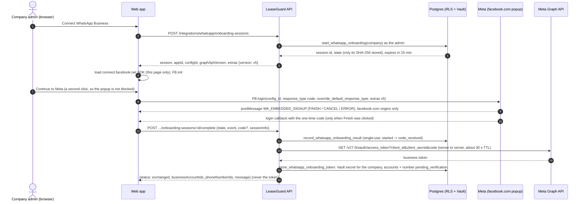
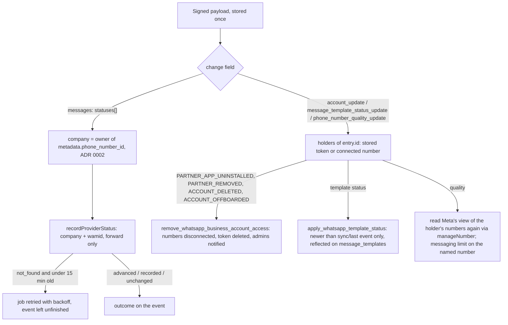
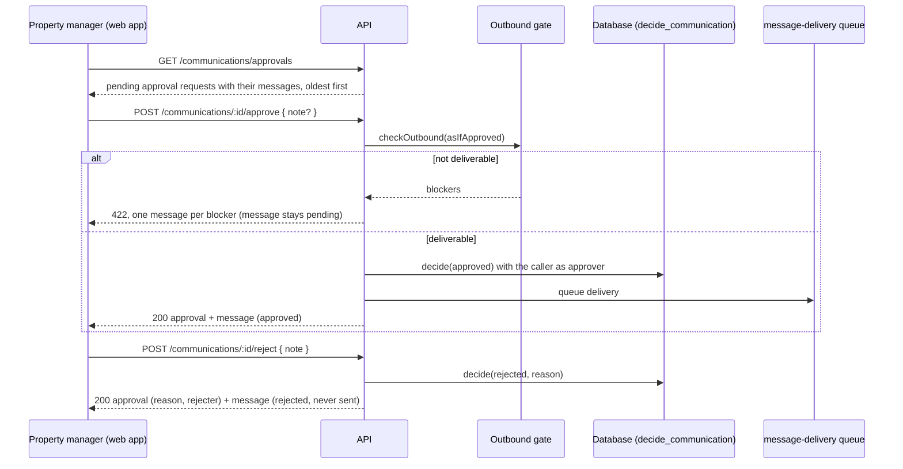

# WhatsApp integration

How LeaseGuard connects each company to WhatsApp (Meta Cloud API), which parts exist today and what
still needs Meta. Meta facts and sources are in
[whatsapp-embedded-signup-research.md](whatsapp-embedded-signup-research.md). Terms follow
[GLOSSARY.md](../../GLOSSARY.md): Company, WhatsApp Business Account, Business number, Receiving number,
WhatsApp channel. Decisions: [ADR 0001](../adr/0001-tenant-messages-always-need-approval.md) (tenant
messages always need approval), [ADR 0002](../adr/0002-inbound-whatsapp-routed-by-receiving-number.md)
(inbound messages are routed by the receiving number only).

This document grows with each WhatsApp ticket. Sections marked with a ticket number describe what that
ticket added.

## Data model (ticket 02)

Migration `supabase/migrations/20261110100400_whatsapp_business_accounts_and_numbers.sql`.

| Table | One row per | Key | Who writes |
| --- | --- | --- | --- |
| `whatsapp_business_accounts` | WhatsApp Business Account of a company | `(company_id, business_account_id)` unique | The service role; and a `SECURITY DEFINER` trigger that records the account of a number written to `whatsapp_phone_numbers`. Signed-in users never write it. |
| `whatsapp_phone_numbers` (formerly `whatsapp_accounts`) | Business number of a company | `(company_id, phone_number_id)` unique; at most one `connected` row per `phone_number_id` across all companies | A `company_admin` may insert or update the Meta ids and display fields only (`PUT /companies/:id/whatsapp`). The connection status, webhook state, last verification, Meta's view of the number and the credential reference are written by the service role only. Nobody signed in deletes. |

- **Several accounts and numbers per company.** A number references its account by the pair
  `(company_id, business_account_id)` (composite foreign key), so a number can only belong to an
  account of its own company.
- **One company per receiving number.** Only a `connected` number owns its `phone_number_id`, and at most
  one connected row may hold it (`whatsapp_phone_numbers_connected_phone_number_id_key`). An admin can
  type any number; it stays `pending_verification`, so a claim can never take over another company's
  number, and a conflict never tells an admin which numbers other companies hold.
- **Meta's view of a number**: `verified_name`, `quality_rating`, `code_verification_status`,
  `name_status`, `meta_status` (Meta's own status, e.g. `CONNECTED`). Service role only; an admin
  changing the number's Meta ids clears them together with the verified connection.
- **Isolation.** Row Level Security: members of a company read its accounts and numbers; members of other
  companies see nothing; `anon` has no privileges. Tests: `supabase/tests/whatsapp_numbers.test.sql`.
- **Credentials.** `whatsapp_phone_numbers.access_token_reference` (`secret://env/…` or
  `secret://vault/…`, see `docs/security/README.md`) is not readable by signed-in users (column grants),
  and every API query selects number columns explicitly. Before this ticket the companies API returned
  it (`secret://vault/<id>`) to every member.

## Embedded Signup (ticket 03)

A company admin clicks **Connect WhatsApp Business** on Settings → Integrations → WhatsApp, completes
Meta's Embedded Signup popup, and the shared number appears **pending verification**. Migration
`supabase/migrations/20261110100600_whatsapp_onboarding_sessions.sql`.



- **Sessions** (`whatsapp_onboarding_sessions`): one row per attempt, status `started` →
  `code_received` → `exchanged` → `completed` (once verification connected its number), or `cancelled` / `failed` / `expired` (`completed` is set by
  verification, ticket 04). A session expires after 15 minutes, can be completed once, and belongs to the
  admin who started it and the company named by `X-Company-Id`; starting again expires that admin's earlier
  open session. Anyone else (another admin, another company, a wrong state) gets 404, a used session 409,
  an expired or superseded one 409 with "expired, or a newer one was started" (and it is marked `expired`). Company admins can read their company's sessions
  (without the state hash); nobody signed in writes them directly.
- **No service-role key in the API.** The four `SECURITY DEFINER` functions (`start_…`,
  `record_whatsapp_onboarding_result`, `fail_whatsapp_onboarding_exchange`,
  `store_whatsapp_onboarding_token`; empty `search_path`, no `anon`/`public` execute) each re-check that
  the caller is an active company admin of the session's company and is the admin who started it.
- **The code** is exchanged synchronously in the complete request, before anything else waits on the
  admin. Only one request can exchange it (the `started` → `code_received` claim). It is never logged or
  stored; neither is the token. The exchange client (`backend/src/infrastructure/whatsapp/embedded-signup-code-exchange.ts`)
  times out after 10 seconds and its errors carry no code, secret or Meta text.
- **The token** goes into Supabase Vault as `whatsapp_access_token:<company id>:onboarding:<session id>`,
  so `whatsapp_account_access_token` (the worker's lookup) only resolves it for that company. Every shared
  WhatsApp Business Account (`whatsapp_business_accounts.access_token_reference`, new, not readable by
  signed-in users) and the shared number reference it. Connecting again replaces the reference and deletes
  earlier Embedded Signup secrets of the company that nothing uses any more.
- **v5 and v4.** The browser forwards Meta's `event` and `data` unchanged. The API reads
  `messaging_account_ids` (v5) and falls back to `waba_id` (v4); `business_id`, `phone_number_id`,
  `is_on_biz_app`, `current_step` and `error_*` are recorded. Unknown fields Meta adds are dropped; known
  ones are validated (numeric Meta ids, lengths). When several accounts are shared, the number is recorded
  under the first; verification (ticket 04) confirms it with Meta.
- **The number** is inserted (or, if the company already had that phone number id, reset) as
  `pending_verification` with no display details; the page shows "Number id …" until verification reads
  them from Meta. If the number moves to a different account, every account Meta shared stays recorded with
  the new token (the shared accounts are upserted after the number, so the admin-edit cleanup trigger of
  20261110100500 cannot remove one of them); a previous account that no number uses and Meta did not share
  is removed. Nothing here marks a number connected, and a pending row never claims another company's
  connected number (the partial unique index of ticket 02).
- **Outcomes explained to the admin** (`message` in the response, also stored as the session's
  `error_message`): CANCEL (the step they left at; nothing connected; start again), ERROR (Meta's code and
  message; start again; quote the code to support), FINISH without a code (the window was closed instead of
  clicking Finish; start again and click Finish), FINISH without account ids (nothing stored), a refused
  code (it expires after about 30 seconds), Meta unreachable, and a failure to store.
- **Browser** (`frontend/src/features/whatsapp-integration/embedded-signup/`): the SDK
  (`https://connect.facebook.net/en_US/sdk.js`) is loaded only when an admin starts connecting;
  `message` events are read only from `https:` origins whose host is `facebook.com` or a subdomain, on the
  default port, with `type: 'WA_EMBEDDED_SIGNUP'`. After the login callback the page waits up to 2 seconds
  for Meta's message; a popup closed without any message counts as a cancel.
- **Then verification:** once the token is stored the API queues the number's verification (ticket 04,
  below). If Redis is unavailable at that moment the signup still succeeds and the admin is told to click
  **Verify again**. Starting and completing a signup is not written to `audit_logs` (the session rows are
  the record).

## Number verification (ticket 04)

After Embedded Signup the worker verifies the number with Meta, and the admin watches each check complete
on Settings → Integrations → WhatsApp. Migration
`supabase/migrations/20261110100700_whatsapp_number_verification.sql`; worker
`backend/src/workers/whatsapp/number-verification.ts` (the steps) and `number-verification.processor.ts`
(queue `whatsapp-number-verification`, the database side).

```mermaid
sequenceDiagram
  autonumber
  actor Admin as Company admin (browser)
  participant API as LeaseGuard API
  participant Redis as Redis (BullMQ)
  participant Worker as Worker (service role)
  participant DB as Postgres (RLS + Vault)
  participant Graph as Meta Graph API
  API->>Redis: after the token is stored: job whatsapp-number-verification.<company>.<number> (ids only)
  Worker->>DB: load the number, its signup (is_on_biz_app), the registration lock; all steps "pending"
  Worker->>DB: whatsapp_account_access_token (the business token, this company's vault secret only)
  Worker->>Graph: GET /debug_token?input_token=<token> (app access token <app id>|<app secret>)
  Worker->>DB: step token_scopes
  Worker->>Graph: GET /<account>/phone_numbers?fields=...,status,platform_type
  Worker->>DB: Meta's view of the number; step phone_number
  Worker->>Graph: POST /<account>/subscribed_apps
  Worker->>DB: step webhook_subscription
  alt WhatsApp Business app number (coexistence) or already on the Cloud API
    Worker->>DB: step registration not_required / passed
  else needs registering, no PIN yet
    Worker->>DB: step registration action_needed ("Register number")
    Admin->>API: POST /integrations/whatsapp/numbers/:id/register {pin}
    API->>Redis: SET <prefix>:whatsapp-registration-pin:<company>:<number> EX 600; job again
    Worker->>Redis: GETDEL the PIN (used once)
    Worker->>Graph: POST /<phone number>/register {messaging_product, pin}
    Worker->>DB: step registration (133016 -> registration_blocked_until = now + 72 h)
  end
  Worker->>Graph: GET /<account>/message_templates (paged)
  Worker->>DB: sync_whatsapp_message_templates; step message_templates
  Worker->>DB: finish_whatsapp_number_verification -> connected only if every step passed
  Admin->>API: GET /integrations/whatsapp/business-accounts (polled every 3 s while a step is pending)
```

- **Steps** (`whatsapp_number_verification_steps`, one row per number and step, worker-written, members
  read): `token_scopes` (Meta's `debug_token` says the token is valid and its `granular_scopes` cover the
  number's WhatsApp Business Account for `whatsapp_business_management` and `whatsapp_business_messaging`; a
  scope without `target_ids` counts as covering it), `phone_number` (Meta lists the number in that account;
  `display_phone_number`, `verified_name`, `quality_rating`, `code_verification_status`, `name_status` and
  `status` are recorded on the number, and the verified name becomes its display name when it had none),
  `webhook_subscription` (`subscribed_apps` returned `success: true`), `registration`, `message_templates`.
  Each has a status (`pending`, `passed`, `failed`, `action_needed`, `not_required`), a message, recovery
  steps and Meta's error code, written for the admin and never containing a token or PIN.
- **Connected only when verified.** `finish_whatsapp_number_verification` (service role only) sets the
  number `connected` (with `webhook_configured` and `last_verified_at`, and the signup that brought it
  `completed`) only when all five steps are `passed` or `not_required`; a failed step gives `error`, anything
  else stays `pending_verification`. The first failed step stops the run and the later ones show "Not
  checked". A number another company already holds connected is never connected: its `phone_number` step
  fails. A number disconnected meanwhile stays disconnected.
- **Registration.** Not required for a WhatsApp Business app number (Embedded Signup reported
  `is_on_biz_app`, coexistence) and passed when Meta reports `platform_type` `CLOUD_API` or `status`
  `CONNECTED`. Otherwise the step asks for a 6-digit PIN: the number's two-step verification PIN if it has
  one, else the PIN it will get. The PIN is never stored (see `docs/security/README.md`): the API puts it in
  one Redis key that expires after 10 minutes and the worker deletes it as it reads it. While a run is in
  progress the API refuses `register` with 409 and stores no PIN (the run may already be past the
  registration step and would never read it); the page offers **Register number** only once the run has
  finished. A run still waiting to start reads the PIN when it reaches the step.
- **Rate limits, no retry storm.** Meta allows 10 registration attempts per number in 72 hours and answers
  error `133016` after that. The worker then records `registration_blocked_until` (now + 72 hours) and a
  message with the end time; while it lasts the API refuses `register` with 429 (nothing reaches Meta) and
  the page hides **Register number**. Registration is never retried automatically: the PIN is consumed
  before Meta is called, so a retried job cannot send it again; a failure says to verify again or enter the
  PIN again.
- **Idempotent and retried.** One job id per number (`whatsapp-number-verification.<company>.<number>`):
  **Verify again** while a run is waiting or in progress returns `already_running`; after a finished run it
  starts a new one (`enqueueOrRetry`). Transient failures (Meta unreachable, throttling, database) are
  retried with BullMQ's backoff (5 attempts) and recorded as failed on the last one. Re-running is safe:
  `subscribed_apps` is idempotent at Meta, a registered number is recognised, and the template sync
  replaces the catalogue.
- **Templates** (`whatsapp_message_templates`, per company and account: Meta's id, name, language, category,
  status, rejection reason, synced time; members read). `sync_whatsapp_message_templates` replaces the
  account's catalogue and reflects Meta's status onto the company's own `message_templates` with the same
  Meta name and language (`APPROVED` → approved; `PENDING`/`IN_APPEAL` → submitted; anything else, e.g.
  `REJECTED`, `PAUSED`, `DISABLED` → rejected), which the outbound gate already requires to be approved. With
  several accounts the last synced account wins for a shared name. A LeaseGuard template that was approved
  or submitted but whose Meta name and language no account of the company holds any more goes back to
  `draft`, so the outbound gate stops sending a template Meta would refuse; templates of the company's other
  accounts count, so syncing one account never downgrades a template another account holds. Since ticket SG-01 the
  sync also reads each template's `components` and keeps Meta's BODY text (`body`) and HEADER format
  (`header_format`; `DOCUMENT` carries the statement PDF).
- **Which template sends which message (ticket SG-01, Settings → Message templates).** `message_type_templates` maps
  each templated message type (the five tenant statement and payment types, then `owner_weekly_summary` and
  `owner_query_response`) to one `message_templates` row. A company admin chooses a synced template
  (`PUT /api/v1/message-templates/{messageType}` → `set_message_type_template`), which copies its name, language,
  category, text, approval, document header and variable names into `message_templates`; communications of the
  type name that row, so the outbound gate keeps refusing it whenever Meta's status is not approved. Rules, checked
  by `@leaseguard/domain` (`templateMappingProblems`) and again by the database: Meta approved it (`APPROVED` or
  `FLAGGED`), not an authentication template, a tenant type takes a Utility template only, LeaseGuard holds its text
  with numbered placeholders `{{1}}…{{n}}`, no banking details, for a tenant type no escalation, lease expiry,
  renewal, dispute, guarantee or deposit wording, and one template sends one type. Every choice is audited on the
  template. A template edited in WhatsApp Manager after it was chosen reads "Text changed" (`metaBodyChanged`) and is
  not sendable until it is chosen again (the approved text is rebuilt into Meta's parameters, so the two must match;
  the outbound gate itself compares the message with the chosen text).
- **Sync again** (`POST /api/v1/message-templates/sync`, company admins): the API queues `whatsapp-template-sync`
  (`backend/src/workers/whatsapp/template-sync.ts`) for one connected number per WhatsApp Business Account. The
  worker opens the number's management (`manageNumber`), lists the templates and calls the same
  `sync_whatsapp_message_templates` as verification step 5, without re-checking the number. Transient failures retry;
  Meta's refusal and a number no longer manageable are recorded in the job's result.
- **Disconnect** (`disconnect_whatsapp_number`, company admins, `SECURITY DEFINER`): the number becomes
  `disconnected` at once (it can no longer send or receive: only a connected number has a channel or owns a
  receiving number), its verification results are deleted, and the token is removed. The decision follows the token,
  not the account (an account shared by several numbers may hold one number's token while the others use an
  env token or a later signup's token): every account of the company stops referencing the token once no
  number of the company in use holds it, and the vault secret is then deleted when nothing of the company
  references it. A token another number in use still holds is kept, and an env-held token (`secret://env/…`)
  cannot be removed from LeaseGuard (the response says so). LeaseGuard does not unsubscribe the app from the account at
  Meta (the token is gone): events for a disconnected number are dropped by receiving-number routing (ADR
  0002), and the business removes LeaseGuard in Meta Business Settings → Integrations → Connected apps. A
  disconnected number is connected again with **Connect WhatsApp Business**.
- **Admin edits** of a number's Meta ids (`PUT /companies/:id/whatsapp`) delete its step results, and a new
  phone number id clears the registration lock.
- **Web app:** each number shows its five steps (passed, not required, failed with Meta's code and "How to
  fix", action needed, not checked yet) and, for company admins, **Register number** (a PIN dialog;
  validated as 6 digits, cleared on open and close), **Verify again** and **Disconnect** (with
  confirmation). A **Message templates** card lists the synced templates. Members who are not admins see
  the steps without actions.

## Inbound routing (ticket 05)

A person messages a company's business number; Meta calls LeaseGuard's single webhook; the message appears in
that company's **Conversations** inbox (`/whatsapp/conversations`). Migrations
`supabase/migrations/20261110100800_recipient_type_contact.sql` and
`supabase/migrations/20261110100900_whatsapp_inbound_routing.sql`; API module
`backend/src/modules/whatsapp-webhook/` (the webhook) and `backend/src/modules/whatsapp-conversations/` (the inbox);
worker `backend/src/workers/whatsapp/inbound-routing.ts` (parsing and routing) and `inbound-webhook.processor.ts`
(queue `whatsapp-webhook`, the database side).

```mermaid
sequenceDiagram
  autonumber
  participant Meta as Meta (WhatsApp Cloud API)
  participant API as LeaseGuard API (public route)
  participant Redis as Redis (BullMQ)
  participant Worker as Worker (service role)
  participant DB as Postgres (RLS)
  actor Member as Company member (browser)
  Meta->>API: GET /api/v1/webhooks/whatsapp?hub.mode=subscribe&hub.verify_token&hub.challenge (once, when configured)
  API-->>Meta: 200 hub.challenge (verify token compared in constant time) | 403
  Meta->>API: POST /api/v1/webhooks/whatsapp, X-Hub-Signature-256, raw body (<= 3 MB)
  API->>API: HMAC-SHA256(app secret, raw bytes) == signature? (timingSafeEqual, before parsing) else 401
  API->>Redis: job whatsapp-webhook.<sha256 of body> {payloadSha256, body, receivedAt} (same body = same job; a failed one is retried)
  API-->>Meta: 200 {received, queued} (503 while Redis is down, so Meta retries)
  Worker->>DB: upsert whatsapp_webhook_events (unique payload_sha256); skip if already processed
  loop each change with field "messages"
    Worker->>DB: forReceivingNumber(metadata.phone_number_id): the CONNECTED number and its company, or none
    alt no company owns the number
      Worker->>DB: outcome unknown_number (recorded on the event, nothing else)
    else
      Worker->>DB: record_whatsapp_inbound_message(company, number, message id, user id, wa_id, name, text, time)
      DB->>DB: number still connected? dedupe by (company, Meta message id); contact by user id, then number;<br/>link a same-company tenant; upsert conversation (last_inbound_at); insert communication (received)
    end
  end
  Worker->>DB: whatsapp_webhook_events.processing_status = processed, outcomes (ids only, no message text)
  Member->>API: GET /api/v1/whatsapp/conversations, GET …/{conversationId} (X-Company-Id, RLS)
```

- **The webhook is public and authenticates Meta.** `@Public()` opts the route out of the Supabase auth guard
  (`backend/src/common/decorators/public.decorator.ts`). The handshake answers only `hub.mode=subscribe` with the
  right `WHATSAPP_WEBHOOK_VERIFY_TOKEN` (403 otherwise, 503 when unset) and echoes only a challenge of safe
  characters, as plain text. The token arrives in the query string, so the request log replaces it with
  `[Redacted]` in the logged url and query (`packages/service-kit/src/logging/redact-url.ts`). Every POST must carry `X-Hub-Signature-256: sha256=<hex>`, the HMAC-SHA256 of the
  exact request bytes keyed with `WHATSAPP_APP_SECRET`: the route reads its body raw (`rawWebhookBody`, registered
  in `main.ts` before Nest's JSON parser, so the global JSON limit of other routes is unchanged), compares in
  constant time, and only then parses. Unsigned, tampered or wrongly signed requests get 401 and queue nothing; a
  body over 3 MB gets 413; a signed payload that is not `whatsapp_business_account` is acknowledged and dropped.
- **The API writes nothing.** It has no service-role key and does not get one: it queues the verified payload.
  The `whatsapp-webhook` job is the one queue payload that is not identifiers only (see `queue-registry.ts`); it
  is removed from Redis once completed (failed jobs are kept 30 days for inspection), and the processed marker and
  the event's unique hash still stop a later retry of the same body. The API queues with `enqueueOrRetry`, so when
  the worker used every attempt (e.g. a long database outage) Meta's redelivery of the same body moves the failed
  job back to waiting with fresh attempts instead of being a no-op on the kept job id; the worker re-processes an
  event that is `failed` and skips one that is `processed`.
- **Idempotency, three layers.** Meta retries for up to 7 days and may re-batch: (1) the same body is one BullMQ job
  (job id = SHA-256 of the body); (2) the same body is one `whatsapp_webhook_events` row, and a processed event is
  not routed again; (3) the same Meta message id is one communication per company
  (`communications_company_external_message_id_key`, was globally unique) and `record_whatsapp_inbound_message`
  returns `duplicate` for it. The function takes a per-company transaction lock, so concurrent deliveries of one
  message, or two first messages of a new sender, cannot both insert.
- **Routing by receiving number only (ADR 0002).** `WhatsAppChannels.forReceivingNumber` (now also returning the
  number's id) names the company only for a `connected` number; the database function re-checks, in the same
  transaction as the writes, that the number is still that company's connected number. A message to an unknown,
  pending or disconnected number is recorded on the event as `unknown_number` and dropped. The sender never chooses
  the company: the same person writing to two companies becomes two contacts, two conversations and two
  communications, one per company.
- **Contacts without a number.** Meta identifies a sender by business-scoped user id (`from_user_id`,
  `contacts[].user_id`), phone number (`from`, `contacts[].wa_id`) or both. `whatsapp_contacts` holds either, with
  per-company unique indexes on each; a later message that brings the other identifier fills it in. A message with
  neither is recorded on the event as `invalid` and not stored. Such a contact's messages have no
  `counterparty_number` (now nullable for inbound messages only) and the inbox says WhatsApp did not share the
  number.
- **Tenants.** A contact whose number equals the WhatsApp number of a tenant of the SAME company is linked to that
  tenant (composite foreign key), and its messages are `recipient_type = 'tenant'` with the tenant id, so they also
  belong to the tenant's communication history. The link does not require the tenant's number to be verified in
  LeaseGuard: Meta reports the sender's own number, and linking is the cautious direction (tenants are never
  answered automatically). Several tenants with one number: the one not vacated, then the most recently added.
  Other senders are `recipient_type = 'contact'` (new enum value). Since ticket 07 an outbound contact message is
  a staff reply in the contact's conversation (see Handovers and replies below).
- **Message text.** Text messages are stored as sent; other types are described (`[Image] caption`,
  `[Document] file name`, `[Voice note]`, `[Location] name, address`, button and list replies as their title,
  `[Reaction] emoji`, `[Unsupported message]`). Media is not downloaded in this version.
- **Not handled yet (recorded, raw payload kept):** every field other than `messages` and the three account-level
  fields of ticket 06 (below). Since ticket 10 every recorded message is queued for the company's AI agent (see
  "The AI agent answers contacts" below).
- **Tables** (all with Row Level Security; `anon` has nothing):

| Table | One row per | Who reads | Who writes |
| --- | --- | --- | --- |
| `whatsapp_webhook_events` | Signed payload (unique `payload_sha256`): raw `payload`, `received_at`, `processing_status` (`received`, `processed`, `failed`), `outcomes` (per change/message: field, receiving number, company, Meta message id, outcome; never text or the sender's number), `error_message` | Service role only (written before the company is known, so it has no `company_id`) | The worker |
| `whatsapp_contacts` | Company counterparty: `user_id` (BSUID) and/or `wa_id`, `profile_name`, optional `tenant_id` of the same company, first/last message times | Members of the company | The worker (`record_whatsapp_inbound_message`) |
| `whatsapp_conversations` | Receiving number + contact of a company (unique), `last_inbound_at` (24-hour window), `last_message_at` | Members of the company | The worker |
| `communications` (changed) | Adds `contact_id`, `conversation_id` (same-company foreign keys) and `received_at`; `counterparty_number` nullable for inbound; Meta message id unique per company | Members (unchanged) | Inbound rows: the worker |

- **Isolation tests:** `supabase/tests/whatsapp_inbound_routing.test.sql` (routing, dedupe, unknown and
  disconnected numbers, BSUID-only senders, tenant links per company, member and anon isolation, raw payloads closed
  to members); `supabase/tests/company_isolation.test.sql` now covers the two new company tables.
- **Not rate-limited in LeaseGuard.** The signature check runs before any parsing or queueing, so an unsigned flood
  costs one HMAC per request and writes nothing; volumetric limits belong at the edge (load balancer / WAF). Meta
  recommends mTLS over IP allow-lists (its IPs change).
- **Retention.** Raw payloads contain message text and phone numbers and are kept in `whatsapp_webhook_events`
  (service role only). No purge job exists yet; one should be added before production volume.

## Delivery statuses and Meta-side disconnects (ticket 06)

Migration `supabase/migrations/20261110101000_whatsapp_statuses_and_disconnects.sql`; worker
`backend/src/workers/whatsapp/inbound-routing.ts` (statuses), `account-events.ts` (account-level events) and
`inbound-webhook.processor.ts` (`DatabaseAccountEventStore`, retry of early statuses). Same webhook, queue and
`whatsapp_webhook_events` row as ticket 05; no new endpoint, queue or setting.



- **Statuses (`messages` field, `value.statuses[]`).** Routed by the receiving number like messages, so a status is
  only ever applied to the receiving number's company. `sent`, `delivered`, `read` and `failed` go through the
  lifecycle's `recordProviderStatus` (`record_communication_provider_status`, ticket 01): the status only moves
  forward along sent → delivered → read, a late `delivered` after `read` only fills its timestamp, a repeat is
  `unchanged`, and `failed` applies only before any delivery evidence. Meta's error becomes the failure reason as
  `WhatsApp error <code>: <title> (<details>)`; never the message text or the recipient. Other Meta statuses
  (`deleted`, `warning`, …) are recorded as `not_handled`. Members see the result where messages are shown (the
  conversations inbox and communication history status badges).
- **A status that overtakes the send.** Meta does not order callbacks, and a `sent` can arrive moments before the
  delivery worker records the WhatsApp message id. When a status names no message of the company yet and is less
  than 15 minutes old, the job fails with `StatusesNotYetRecordedError` and BullMQ retries it with its backoff
  (30 s, 1, 2, 4 min); the event stays `received` meanwhile. Re-routing the whole payload is safe (messages are
  deduplicated, statuses are monotonic). On the last attempt, or at once for an older status (e.g. a message sent
  outside LeaseGuard from the same number), the status is recorded as `not_found`.
- **Who an account event applies to.** Account-level events carry no receiving number, only the WhatsApp Business
  Account (`entry[].id`; `waba_info.waba_id` for `account_update`). They apply to the companies that **hold verified
  access** to that account (`whatsapp_business_account_holders`): a business token stored by Embedded Signup, or a
  number LeaseGuard verified and connected. A company that only typed the same account id is never affected; an
  account no company holds is recorded as `no_holder`. The entry `time` orders the events.
- **Uninstall / removal (`account_update`).** `PARTNER_APP_UNINSTALLED`, `PARTNER_REMOVED`, `ACCOUNT_DELETED` and
  `ACCOUNT_OFFBOARDED` end LeaseGuard's access. For each holder, `remove_whatsapp_business_account_access`
  (SECURITY DEFINER, service role only) in one transaction: marks the company's numbers in the account
  `disconnected` (no webhook, no verification, credential dropped, `disconnected_reason` and `disconnected_at`
  recorded), deletes their verification steps, clears the account's token reference, deletes the Vault secret once
  nothing of the company references it, and inserts one `critical` `system` notification per active company admin
  ("WhatsApp disconnected in Meta", deduplicated per admin and event). The notification says how each number is
  connected again: with Connect WhatsApp Business, or, for a number from the number import (`operator_imported_at`
  set), by asking Nexus Solution to import it again; an account with both kinds names both (the function is redefined
  for this in 20261111100500). A token stored, or a number verified, after
  the event's time is a newer grant and is left alone, so a late event never undoes a reconnect. A retried event
  finds nothing in use and notifies nobody again. An uninstall that names another app (`partner_app_id` differs from
  `WHATSAPP_APP_ID`, when set) is recorded as `other_app`. Other `account_update` events (`ACCOUNT_RESTRICTION`,
  `DISABLED_UPDATE`, `ACCOUNT_VIOLATION`, …) are recorded as `not_handled`. Tenants are never told.
- **Template status (`message_template_status_update`).** `apply_whatsapp_template_status` updates the holder's synced
  template (status, Meta's reason, `status_updated_at`) only when the event is newer than both the last sync and the
  last event (`stale` otherwise); adds a template it had not synced when Meta names it; removes it on `DELETED`; and
  reflects the status onto the company's own `message_templates` with the same Meta name and language like the sync:
  `APPROVED` and `FLAGGED` (Meta still sends a flagged template) → approved, `PENDING` and `IN_APPEAL` → submitted,
  anything else → rejected; a deleted template goes back to draft unless another account of the company holds it.
  The sync (`sync_whatsapp_message_templates`, redefined in 20261110101000) uses the same mapping,
  `private.whatsapp_template_approval`, so a webhook and the next sync agree. `REINSTATED` is applied as `APPROVED`.
  Only events that name a status are applied (`APPROVED`, `REJECTED`, `PENDING`, `PAUSED`, `DISABLED`, `FLAGGED`,
  `IN_APPEAL`, `LIMIT_EXCEEDED`, `ARCHIVED`, `DELETED`, `PENDING_DELETION`); any other event (`UNARCHIVED`, `LOCKED`,
  …) does not say what the status now is, so it is recorded as `not_handled` and the template is left as it is until
  the next sync (the function itself refuses a non-status with 22023). A status for an unknown template without a name
  is `unknown_template`. An event without `entry.time` is applied at the time it is processed. The admins'
  notification says the stored token was deleted only when it was.
- **Quality (`phone_number_quality_update`).** The webhook names the number (`display_phone_number`) and Meta's
  messaging limit (`max_daily_conversations_per_business`, or the older `current_limit`), not the quality rating. The
  worker therefore reads Meta's view of the holder's numbers in the account again through
  `WhatsAppChannels.manageNumber(…).accountPhoneNumbers()` (the token stays in the channel module) and records
  quality rating, verified name, name and code verification status and Meta status for each; the messaging limit is
  recorded on the named number, forward only in Meta's time. When no number of the account has a usable credential, or
  Meta refuses (e.g. an invalidated token), the outcome is `meta_unavailable`; when Meta is unreachable the job retries.
- **Integration page.** A number disconnected in Meta shows "Disconnected in Meta on <date>", the reason, that
  LeaseGuard no longer has access to it in Meta (it does not claim a token deletion, which the page cannot know), and that a company admin reconnects with Connect WhatsApp Business (for an imported number: ask Nexus Solution to import it again). The Meta column shows
  the messaging limit next to the quality rating. The template card shows `FLAGGED` as a warning and its "Last
  updated" column uses Meta's status time when it is newer than the sync.
- **Columns** (members read, only the service role writes): `whatsapp_phone_numbers.disconnected_at`,
  `disconnected_reason` (both cleared when the number leaves `disconnected`), `messaging_limit_tier`,
  `messaging_limit_updated_at`; `whatsapp_message_templates.status_updated_at`. API fields: `disconnectedAt`,
  `disconnectedReason`, `messagingLimitTier` on numbers, `statusUpdatedAt` on templates.
- **Tests:** `backend/src/workers/whatsapp/inbound-routing.test.ts` (status routing, order, repeats, other company,
  failure reason), `account-events.test.ts`, `inbound-webhook.processor.test.ts` (early-status retry, uninstall call,
  quality refresh and its failures), `supabase/tests/whatsapp_statuses_and_disconnects.test.sql` (holders, removal
  isolation, token deletion, late events, notifications, template ordering and reflection, privileges),
  `tests/integration/whatsapp-statuses-and-disconnects.test.ts` (through the API), and the frontend component tests.
  The out-of-order transition itself is covered by `supabase/tests/communication_lifecycle.test.sql`.

## Handovers and replies to contacts (ticket 07)

Migration `supabase/migrations/20261110101100_whatsapp_handovers_and_replies.sql`; API
`backend/src/modules/whatsapp-conversations/` (`WhatsAppConversationActionsService`); the outbound gate
`backend/src/messaging/outbound-gate.ts` (`checkContactReply`, and the contact path of `checkOutbound`); the rules in
`packages/domain/src/rules/contactReply.ts` (`customerServiceWindow`, `canReplyToContact`); web
`frontend/src/features/whatsapp-conversations/`. No new setting, queue or worker job: a reply uses the existing
`message-delivery` queue and worker.

```mermaid
sequenceDiagram
  participant W as Writer (web app)
  participant A as API (signed-in user's client)
  participant D as Postgres
  participant Q as message-delivery queue
  participant K as Worker (service role)
  participant M as Meta Graph API
  W->>A: POST /whatsapp/conversations/:id/replies { body }
  A->>D: checkContactReply (gate): not a tenant, window open, number known, conversation's number connected, no banking details
  A->>D: reply_to_whatsapp_contact (invoker): insert pending_approval + approval request, decide_communication(approved)
  D-->>A: created (guard_contact_message re-checks contact, tenant link and window)
  A->>Q: enqueue message-delivery (company, communication)
  A-->>W: 201 Communication (approved)
  K->>D: checkOutbound (gate, contact path, same rules at send time)
  K->>D: claim_communication (guard refuses after the window closed or once the contact is a tenant)
  K->>M: send text from the conversation's phone_number_id
  K->>D: recordSent; Meta's statuses arrive through the webhook (ticket 06)
```

- **Handovers.** `whatsapp_handovers` holds requests for a person to take a conversation over: `requested_by`
  `agent` (the AI agent, ticket 10) or `member`, a reason, the member who handles it (`assigned_user_id`), status
  `open` → `accepted` → `resolved` with times, who resolved it and a note. A conversation has at most one unresolved
  handover (partial unique index); resolved ones are kept. Members of the company read them (RLS); nobody but the
  service role writes the table directly. Company writers act through three SECURITY DEFINER functions, executable by
  `authenticated` only, each checking that the caller is an active `company_admin` or `property_manager` of the
  conversation's company (`private.require_conversation_writer`, else 42501) and locking the conversation row:
  `accept_whatsapp_handover` (accepts the open handover for the caller, or starts one the caller accepts; refuses with
  `accepted_by_other` when a colleague already accepted it), `assign_whatsapp_handover` (to an active writer of the
  company only: open until they accept, accepted when it is the caller) and `resolve_whatsapp_handover`.
- **Replies to contacts.** A reply is an outbound communication with `recipient_type` `contact` and
  `message_type` `manual` in the contact's conversation, from the number the conversation came in on, to the contact's
  WhatsApp number. It goes through the communication lifecycle like every other message: `reply_to_whatsapp_contact`
  (SECURITY INVOKER, so RLS, column grants and every message and approval guard apply to the signed-in writer)
  creates it as an approval request and records the writer's own approval with `decide_communication` in one
  transaction; the writer who writes a reply is its approver. The API then queues it on `message-delivery`; the worker
  asks the outbound gate again, claims it and sends it as plain text through `WhatsAppChannels.forCompany(company,
  { phoneNumberId })`. Statuses come back through the webhook (ticket 06). If Redis is unreachable after the reply was
  written, the API answers 503 and the reply stays approved; `POST /communications/:id/approve` queues it again.
- **The rules, in four places.** `canReplyToContact` (@leaseguard/domain): the contact is not a tenant, the 24-hour
  customer service window from the contact's last message (`whatsapp_conversations.last_inbound_at`) is open, and
  WhatsApp shared the contact's number (a contact known only by a business-scoped user id cannot be replied to yet).
  The web app uses it to disable the reply box with the reasons; the outbound gate uses it before the reply is
  written (`checkContactReply`, plus content rules: no banking details; plus the conversation's number connected) and
  before it is sent (`checkOutbound`, plus a recorded approval that names its approver, the contact's number unchanged
  and no template); the database enforces it with `private.guard_contact_message` (an outbound contact message
  belongs to a conversation of that contact; the contact is not linked to a tenant; a signed-in user creates one only
  inside the window; nobody claims one for sending after the window closed or once the contact is linked to a tenant)
  and in `reply_to_whatsapp_contact` (outcomes `tenant`, `no_number`, `window_closed`, `number_not_connected`).
- **No free-form reply reaches a tenant.** A conversation whose contact is linked to a tenant refuses replies at
  every layer above, and the existing check constraint keeps any outbound message addressed to a tenant
  (`recipient_type` `tenant`) to the approved statement and payment types. Tenants keep receiving only approved
  tenant messages through the approval flow (ADR 0001).
- **Columns and grants.** `communications_recipient_check` now allows an outbound `contact` message with a
  conversation; `authenticated` may insert `contact_id` and `conversation_id` (not update them).
- **Tests:** `packages/domain/src/rules/contactReply.test.ts`, `backend/src/messaging/outbound-gate.test.ts`
  (contact path and `checkContactReply`), `backend/src/workers/messaging/message-delivery.processor.test.ts` (sent
  from the conversation's number, refused outside the window and to a tenant),
  `backend/src/modules/whatsapp-conversations/*.test.ts`, `supabase/tests/whatsapp_handovers_and_replies.test.sql`
  (roles, assignees, company mix-ups, at most one unresolved handover, reply outcomes, direct writes, the claim guard,
  isolation), `tests/integration/whatsapp-handover-and-replies.test.ts` (through the API and with a writer's own
  database sign-in), the inbox component tests and `tests/e2e/whatsapp-integration.spec.ts`.

## Approvals in the app (ticket 08)

Tenant messages (monthly statements and payment reminders) are created awaiting an approval (ADR 0001); a property
manager decides on each one in the web app. The decision endpoints existed before this ticket (ticket 01: outbound
gate and lifecycle); ticket 08 adds the screen and the tests that prove the rules end to end.



- **Who**: every member of the company sees the queue; only `company_admin` and `property_manager` approve or reject
  (403 otherwise). The requester may approve their own request (single-manager companies must be able to send).
- **Blockers**: approving runs every check the delivery worker applies (tenant eligibility: statement and payment
  types only, verified and not opted out, arrangement suppression; the tenant's number unchanged; no banking details;
  the company's WhatsApp channel connected; the template approved by Meta and matching). When any fails, the API
  answers 422 listing each one, nothing is recorded, and the screen shows them on the message under "This message
  cannot be sent yet". The message stays pending until it is fixed and approved again, or rejected.
- **Reject**: a reason is required (1–1 000 characters, trimmed; 400 when blank). It is stored as the approval's
  `reason` with the rejecter and time, and written to the audit trail by the database; the message is never sent.
- Tenants are never told about a rejection: rejection sends nothing.
- Tests: `frontend/src/features/communications/components/ApprovalsQueue.test.tsx` (loading, empty, error, read-only,
  approve, 422 blockers, 409, reject with reason), `frontend/src/features/communications/api/apiSource.test.ts`,
  `tests/integration/approvals.test.ts` (422 blockers, 403 for read-only approve and reject, 400 blank reason, reason
  and rejecter recorded, no delivery job on rejection, queue visible to read-only members and never to another
  company) and `tests/e2e/approvals.spec.ts` (blockers shown, approve, reject with a reason, read-only view).

## AI agent and knowledge base (ticket 09)

Each company configures its own AI agent and knowledge base. This ticket stores and edits them; the agent that
answers contacts from them is ticket 10. Migration `supabase/migrations/20261111100000_whatsapp_agent_and_knowledge.sql`.

| Table | One row per | Who writes |
| --- | --- | --- |
| `whatsapp_agent_configs` | Company (the company id is the key) | Company admins, through `save_whatsapp_agent_config` (security invoker, so RLS applies) |
| `whatsapp_agent_handover_contacts` | Member told when the agent hands a conversation to a person | Saved with the configuration; each must be an active company admin or property manager of the company (22023 otherwise); a member who leaves is removed (FK cascade) |
| `whatsapp_knowledge_faqs` | FAQ (question, answer) | Company admins |
| `whatsapp_knowledge_entries` | Knowledge entry (title, text) | Company admins |
| `whatsapp_knowledge_documents` | Document in the private bucket `agent-knowledge` at `<company_id>/<document_id>/<file>` (PDF, PNG, JPEG or plain text, 10 MB) | Company admins (signed upload, then registration) |

- **Configuration**: agent name, business description, tone, time zone (default `Africa/Johannesburg`), operating
  hours (`[{ day, opens, closes }]`, `HH:mm`, no overlaps per day), languages (South African languages), policies,
  support instructions, escalation rules, handover contacts, permitted actions (`answer_faq`, `share_business_info`,
  `share_approved_document`, `capture_enquiry`, `draft_tenant_reply`; the last only drafts an internal suggestion
  for staff), `auto_reply_enabled` (off by default) and an out-of-hours message. Until an admin saves one, the API
  returns the defaults with `configured: false`: nothing permitted, auto-reply off.
- **Draft and approved**: a signed-in user's new item is always a draft; changing an approved item's content makes it
  a draft again (the content cannot change and be approved in one step); approving stamps the approver and time from
  the caller (column grants stop clients writing the stamp); company admins can return an item to draft. Approving
  knowledge and saving the configuration are written to the audit log.
- **Isolation**: every member of the company reads all of it (staff answering conversations see what the agent
  knows); only company admins write (RLS `company_ids_with_role('{company_admin}')`, and the API's role guard answers
  403 first). Nothing of one company is visible to another; the storage policies allow the same per company prefix.
- **What the agent may read**: `public.whatsapp_agent_knowledge(company)`, executable by the service role only,
  returns one company's configuration, its handover contacts who are still active admins or property managers, and
  its APPROVED FAQs, entries and documents (metadata). Drafts and other companies' rows are never returned. The worker
  reads it with `loadAgentKnowledge(db, companyId)` (`backend/src/messaging/agent-knowledge.ts`), the seam ticket 10
  builds the agent's prompt from.
- **Safeguards that do not depend on the configuration** (shown on the settings page): tenants are never answered
  automatically (ADR 0001); only approved knowledge of the company is used; complaints, payments, arrangements,
  disputes, lease expiry, renewals and low confidence go to a person; banking details are never sent; auto-reply only
  answers contacts inside the 24-hour customer service window and operating hours. Ticket 10 enforces them in code.
- Tests: pgTAP `supabase/tests/whatsapp_agent_and_knowledge.test.sql` (privileges, member/admin rules, draft and
  approval stamps, cross-company writes and storage, the agent's read), the company isolation suite (34 company
  tables), unit tests for the API services, the schemas and `loadAgentKnowledge`, `packages/domain` rules
  (`operatingHoursProblems`, `autoReplyWarnings`), `tests/integration/whatsapp-agent-and-knowledge.test.ts` and
  `tests/e2e/whatsapp-agent.spec.ts`.

## The AI agent answers contacts (ticket 10)

When someone messages a company, the company's AI agent (Claude) answers frequently asked questions from that
company's approved knowledge only, inside WhatsApp's 24-hour customer service window and the company's operating
hours, when a company admin turned auto-reply on. Everything else goes to a person: tenants are never answered
automatically (an internal suggested reply for staff plus a handover); complaints, payments and arrangements,
disputes, lease questions, refusals, model errors and low confidence are handed over and the handover contacts are
notified. Replies never contain bank details. Migration `supabase/migrations/20261111100100_whatsapp_agent_runs.sql`;
runtime `backend/src/messaging/agent-runtime.ts`; policy `packages/domain/src/rules/agentPolicy.ts`; worker queue
`whatsapp-agent` (`backend/src/workers/whatsapp/agent-reply.processor.ts`).

```mermaid
sequenceDiagram
  autonumber
  participant Webhook as Worker: whatsapp-webhook
  participant Redis as Redis (BullMQ)
  participant Agent as Worker: whatsapp-agent
  participant DB as Postgres (service role)
  participant Claude as Claude (claude-opus-5-5)
  participant Delivery as Worker: message-delivery
  Webhook->>DB: record_whatsapp_inbound_message (recorded | duplicate, communication id)
  Webhook->>Redis: job whatsapp-agent.<company>.<message> (same id for a retry: one job)
  Agent->>DB: start_whatsapp_agent_run (one run per message; completed => never again, re-queue its reply)
  Agent->>DB: the company's config + APPROVED knowledge (whatsapp_agent_knowledge), the conversation (same company)
  alt agent configured
    Agent->>Claude: one Messages call: instructions + company knowledge (cached), conversation, new message
    Claude-->>Agent: decision JSON (structured output) | refusal | error
  end
  Agent->>Agent: applyAgentPolicy (tenant? guards, permitted action, window, hours, confidence)
  Agent->>DB: complete_whatsapp_agent_run: reply (agent-approved) | handover + notifications, usage
  Agent->>Redis: job message-delivery.<company>.<reply> (when a reply was created)
  Delivery->>DB: outbound gate + claim (lifecycle), then send through the company's number
```

- **One run per message, safe under retries.** `whatsapp_agent_runs` is unique per company and inbound message.
  `start_whatsapp_agent_run` creates the run or returns it; a completed run is never run again, so Claude is asked
  once and nothing is sent twice. `complete_whatsapp_agent_run` locks the conversation and the run and does
  everything at once: the reply, its approval, the handover and the notifications, and the run's outcome. A crash
  before completing leaves a `started` run with nothing sent, which the retry runs again. A crash after completing
  but before queueing delivery is repaired by the retry (it re-queues the run's reply; the delivery job id and the
  lifecycle's claim make that a no-op if it was queued). The webhook queues the agent for a duplicate message too,
  in case an earlier attempt stopped between recording and queueing.
- **Only the company's own approved information.** The prompt (`backend/src/messaging/agent-prompt.ts`) is built
  from `loadAgentKnowledge(db, companyId)` (approved FAQs, entries and document titles of that company only) and the
  conversation's last 12 messages, read with an explicit company filter. No tenant financial data, no storage paths,
  no ids, no secrets. The person's text is wrapped in `<message>` tags and the instructions say it is never an
  instruction. WhatsApp data is only sent to Claude to answer the message; it is not used to train anything.
- **The policy in code, after the model** (`applyAgentPolicy`, @leaseguard/domain):

| Situation | What happens |
| --- | --- |
| Sender is a tenant (linked contact, a tenant recipient, or a tenant of the company with the contact's number) | Never a message. Handover "Message from a tenant"; the model's draft is kept as an internal suggestion only when `draft_tenant_reply` is permitted |
| Model refused (`stop_reason: refusal` after the server-side fallbacks), errored after the job's last attempt, or no `ANTHROPIC_API_KEY` | Handover with the reason |
| Message about payments, arrangements, disputes, lease expiry, renewals or escalations (keyword guard), or the model's category is complaint, payment_or_arrangement, dispute or lease_question | Handover with the reason |
| Model asked for a person, or confidence below 0.7 | Handover |
| Nothing to answer (model: ignore, confident) | Nothing (outcome `ignored`) |
| Auto-reply off, or a person already handles the conversation | Handover; the draft is kept as an internal suggestion |
| The answer's category needs a permitted action (`faq` → `answer_faq`, `business_info` → `share_business_info`, `document_request` → `share_approved_document`; anything else is handed over), and the answer is non-empty, at most 1 000 characters, with no bank details (never kept, not even as a suggestion) and no payment, dispute, lease-expiry, renewal or escalation content | Otherwise handover |
| Outside operating hours (in the company's time zone; no hours = never open) | The out-of-hours message, at most once per window (not again since the business closed nor within 24 hours), plus a handover so a person follows up |
| Outside the 24-hour window, or WhatsApp did not share the contact's number | Handover (no free-form message) |
| Otherwise | The answer is sent (outcome `replied`) |

- **The agent's reply goes through the normal path.** `complete_whatsapp_agent_run` re-checks in the same
  transaction (not a tenant, a number, the window, the number connected, out-of-hours dedupe) and creates the reply as
  an outbound `contact` message from the conversation's number, with a message approval decided by the run
  (`message_approvals.decided_by_agent_run_id`; no person requested or decided it) and the lifecycle operation
  `agent_approve` (`pending_approval → approved`, backend only, added to the transition table; the table is now keyed
  by actor too). The delivery worker then sends it exactly like a member's reply: the outbound gate accepts an agent
  approval for a contact message only (never a tenant message), checks the window and content again, and the
  lifecycle's claim makes the send happen at most once. A signed-in user cannot set `decided_by_agent_run_id` (column
  grants), and a check constraint keeps it to approved, person-less approvals.
- **Handovers and notifications.** A new agent handover (unless the conversation already has an unresolved one)
  notifies each handover contact who is still an active company admin or property manager, or, when none is
  configured, every active company admin and property manager, so a handover is never silent. Notifications are
  `system` / `warning`, link the inbound message, and are deduplicated per handover and user.
- **Claude API.** Official SDK `@anthropic-ai/sdk` 1.3.0 (worker only), model `claude-opus-5-5`, one call per
  message through `client.beta.messages.create` with the `server-side-fallback-2026-07-01` beta and `fallbacks:
  'default'` (a policy decline is retried on Anthropic's default fallback model inside the call; the run records the
  model that answered; a final `refusal` hands over). Structured outputs (`output_config.format`, JSON schema with
  `action`, `reply_text`, `handover_reason`, `category`, `confidence`), never a forced tool. `output_config.effort`
  from `WHATSAPP_AGENT_EFFORT` (default `low`); no `thinking` parameter (this model always thinks adaptively and
  rejects `disabled` or a budget). Prompt caching: fixed instructions, then the company's knowledge with the cache
  breakpoint, then the conversation and the new message. Errors by the SDK's typed classes: rate limits, overload,
  5xx and connection errors are retried by the job (5 attempts with backoff, plus the SDK's own 2 retries) and then
  handed over; a rejected key, permissions or a bad request hand over at once. The model sits behind the `AgentLlm`
  seam (`backend/src/messaging/agent-llm.ts`, adapter `anthropic-agent-llm.ts`), with a deterministic fake
  (`agent.test-helpers.ts`) in every test: no test calls Anthropic.
- **What runs record** (`whatsapp_agent_runs`): status, outcome, category, confidence, handover reason, the internal
  suggested reply, the reply sent, the handover, model, stop reason, input/output/cache-read/cache-creation tokens,
  latency and a safe error text. Never the prompt or a key. Members of the company read them (the inbox shows them);
  only the worker writes them.
- **Inbox.** `GET /api/v1/whatsapp/conversations/{conversationId}` now returns `agentRuns` (oldest first, without the
  error text). The thread shows, under each inbound message, what the agent did, the handover reason and the
  suggested reply marked "internal, not sent", and marks the messages the agent sent. Approvals (ticket 08) carry
  `decidedByAgentRunId` and an optional `requestedByUserId`.
- **Not in this version:** the agent does not send documents (a document request is answered in text from the
  document's title and description, or handed over); `capture_enquiry` has no effect yet; the agent does not
  re-run when a person resolves a handover.
- **Tests:** domain `agentPolicy.test.ts` (every rule, operating hours, out-of-hours window), backend
  `agent-runtime.test.ts` (in-memory store + fake model: tenant never sent, FAQ reply, once per message, retries,
  refusal, bank details, window, out of hours), `agent-prompt.test.ts` (deterministic, own company only, tag
  escaping), `anthropic-agent-llm.test.ts` (request shape with a fake fetch: beta header, fallbacks, effort, schema, no
  thinking or tool choice, cache breakpoint; refusal; typed error mapping), `outbound-gate.test.ts` (agent approval
  for contacts only), `inbound-webhook.processor.test.ts` (agent queued for recorded and duplicate messages), pgTAP
  `supabase/tests/whatsapp_agent_runs.test.sql` (once-only, reply re-checks, out-of-hours dedupe, tenants,
  notifications, privileges, isolation) and `tests/integration/whatsapp-agent-answers.test.ts` (two companies' agents
  on the local stack: each prompt only its own approved knowledge, one reply, tenant handover, out-of-hours once, API
  and RLS isolation).

## WhatsApp setup, test messages and activation (ticket 11)

A company admin sees the company's WhatsApp setup as ten steps on Settings → Integrations → WhatsApp (and a summary on
the dashboard), sends a test message, and activates WhatsApp once every required step is verified. Migration
`supabase/migrations/20261111100200_whatsapp_setup_and_test_messages.sql`; worker
`backend/src/workers/whatsapp/test-message.ts` (the send), `test-message-store.ts` (its database side and the status
fallback) and `test-message.processor.ts` (queue `whatsapp-test-message`); API `whatsapp-setup.service.ts`; step titles
and guidance `packages/domain/src/rules/whatsappSetup.ts`.

| # | Step | Required | Done when LeaseGuard has verified (never from what an admin typed) |
| --- | --- | --- | --- |
| 1 | Business profile | Yes | The company name, address, contact email and phone are filled in |
| 2 | Meta account connected | Yes | The company is an account holder: a business token stored through WhatsApp signup, or a connected number. A signup in progress is *waiting on Meta* |
| 3 | WhatsApp Business Account connected | Yes | Meta's `debug_token` covered the account (number verification's `token_scopes` passed) while the company holds a token, or a number is connected |
| 4 | Phone number verified | Yes | Meta lists the number in the account (`phone_number` passed) and it is registered (`registration` passed or not required), or it is connected |
| 5 | Webhook connected | Yes | Meta accepted `subscribed_apps` for the account (`webhook_subscription` passed, or a connected number with `webhook_configured`) |
| 6 | Message templates ready | Yes | Meta approved at least one `UTILITY` template (synced or from Meta's template status webhook). Templates in review: *waiting on Meta* |
| 7 | AI agent configured | No (recommended) | A company admin saved the agent configuration |
| 8 | Knowledge base configured | No (recommended) | At least one approved FAQ, knowledge entry or document |
| 9 | Test message successful | Yes | A test message from a number that is still connected reached `delivered` or `read` (Meta's status webhook). Queued, sending or sent: *waiting on Meta* |
| 10 | Ready for activation | | Every required step is done |

- **States**: `done`, `action_needed` (the admin acts next; the page says what to do and links to it), `waiting_on_meta`
  (a signup, verification, template review or test message delivery is in progress; the page polls every 3 seconds
  except for template review) and `blocked` (an earlier step comes first). Steps 7 and 8 are recommended: the agent is
  optional (auto-reply is off by default), so they do not block activation.
- **One computation**: `private.whatsapp_setup_steps(company)` (`SECURITY DEFINER`, it reads facts members cannot read,
  such as the stored token reference and other admins' signups; it returns step names and states only).
  `public.whatsapp_setup_status(company)` returns it to members of that company (42501 for anyone else), and the
  activation guard uses the same function, so the page and the guard cannot disagree. The API adds titles and guidance
  (`whatsAppSetup` in @leaseguard/domain) and never recomputes readiness.
- **Test messages** (`whatsapp_test_messages`, company-scoped; company admins read them, nobody signed in writes them).
  `request_whatsapp_test_message` (company admins, `SECURITY DEFINER`, re-checks the role) refuses a number of another
  company or not connected, a template not in the number's WhatsApp Business Account or not `APPROVED`, a recipient
  that is a **tenant** of the company (tenants only ever receive approved statement and payment messages, ADR 0001),
  and more than 10 test messages per company per hour. The API queues job `whatsapp-test-message.<company>.<test
  message>`; if Redis is down it marks the test message failed and answers 503. The worker re-checks the number, the
  template and the tenant rule, claims the message (`queued` → `sending`, one run only), sends Meta's template **without
  parameters** from that number through `WhatsAppChannels.forCompany(company, { phoneNumberId })`, and records
  `sent` with Meta's message id. Throttling is retried after handing the claim back; an unknown outcome is never
  retried (`may_have_been_sent`); Meta's refusal (for example `#132000` for a template with placeholders) is shown to
  the admin. A test message is not a communication: it never appears in the inbox, approvals or analytics.
- **Statuses**: the webhook worker applies a status that matches no communication of the receiving number's company to
  that company's test message (`record_whatsapp_test_message_status`, service role, forward only along sent →
  delivered → read, `failed` only before delivery). Only `delivered` or `read` completes step 9.
- **Activation** (`companies.whatsapp_activated_at`, `whatsapp_activated_by_user_id`): `activate_company_whatsapp`
  and `deactivate_company_whatsapp` (company admins). The trigger `guard_whatsapp_activation` refuses setting the
  activation while a required step is not done, for every role including the service role, and a new company cannot
  start active. Activation records the company's go-live decision; it does not yet switch any sending on or off (the
  existing gates still decide: a connected number, approvals, the customer service window). If a step later stops
  being verified (for example the number is disconnected), the company stays marked active and the page and dashboard
  say that a required step is no longer verified.
- No new setting: the test message uses the company's own number and stored token, like any other send.

## Communication analytics (ticket 12)

Migration `supabase/migrations/20261111100300_communication_analytics.sql`; API `GET /api/v1/communications/analytics`
(`backend/src/modules/communications/communication-analytics.service.ts`); web page Communications → Analytics
(`/communications/analytics`) and a dashboard card. No new table, queue, worker job or setting.

- **What counts** (`public.communication_analytics(company, from, to)`), over South African calendar days
  (Africa/Johannesburg), both dates included, at most 366 days (default: the last 30 days, today included):

  | Figure | Counted from |
  | --- | --- |
  | Received (`inbound`) | Inbound WhatsApp communications recorded that day (tenants, owners, contacts) |
  | Sent (`outbound`) | Outbound WhatsApp communications recorded that day and handed to WhatsApp: `queued`, `sent`, `delivered`, `read` or `failed`. Drafts, messages awaiting approval and rejected messages are not sent |
  | Delivered / Read / Failed | Of those, by their latest status: `delivered` or `read` / `read` / `failed` (Meta's statuses, ticket 06) |
  | Handovers opened (`handovers`, `agentHandovers`) | Handovers opened that day; how many the AI agent opened |
  | Answers sent, Out-of-hours messages, Suggested replies | AI agent runs started that day with outcome `replied` / `out_of_hours`, and runs with an internal suggested reply (never sent) |

  A message counts on the day it was recorded with its current status, so a message sent on the 30th and read on the
  1st counts as read in the range that holds the 30th. Email and system messages do not count, and test messages
  (ticket 11) are not communications.
- **Isolation.** The function is `SECURITY INVOKER` (empty `search_path`): it reads as the caller, so Row Level
  Security applies to every table it counts, and it refuses (42501) anyone who is not an active member of the named
  company rather than answering zeros. Execute is granted to `authenticated` only (not `anon`, not the service role).
  The API calls it with the caller's client and the `X-Company-Id` company; a member of two companies gets each
  company's figures separately, never a sum. Tests: `supabase/tests/communication_analytics.test.sql` (two companies,
  day boundaries, ranges, refusals), `backend/src/modules/communications/communication-analytics.service.test.ts`,
  `tests/integration/communication-analytics.test.ts` (A's members, B's member, a direct Data API call with A's token
  for B refused).
- **Indexes** `whatsapp_handovers (company_id, created_at)` and `whatsapp_agent_runs (company_id, created_at)` for
  the period counts; communications already had `(company_id, created_at desc)`.
- **Works now** on the local stack and needs no Meta approval or configuration: it counts LeaseGuard's own records.
  With real traffic the figures fill as messages arrive (webhook), are sent (worker) and Meta reports their status
  (webhook `messages` field); without the webhook, sent messages never reach delivered or read.

## Settings → Users (ticket 13)

No migration, endpoint, queue, worker job or setting is new: the screen uses the existing member and invitation API
(`backend/src/modules/users/`, `backend/src/modules/invitations/`), the database rules of
`20261109102000_membership_management.sql` and the invitation worker (`backend/src/workers/invitations/`). It is here
because WhatsApp work depends on it: handover contacts, approvers and integration settings are members with roles.

| Endpoint | Who | Refusals the screen explains |
| --- | --- | --- |
| `GET /api/v1/users` (with `role=company_admin&status=active&pageSize=1` for the admin count) | every member | – |
| `PATCH /api/v1/users/{userId}/role` | company admins | 403 own role; 409 last active company admin; 404 no longer a member |
| `DELETE /api/v1/users/{userId}` | company admins | 403 yourself; 409 last active company admin, or still named on company records (property manager, lease verifier, …) |
| `GET /api/v1/invitations`, `POST /api/v1/invitations` | company admins | 409 the email has an open invitation or belongs to a member (shown on the email field); 403 other roles |
| `POST /api/v1/invitations/{id}/resend` | company admins | 409 not pending, sent or failed; 404 |
| `POST /api/v1/invitations/{id}/revoke` | company admins | 409 not pending or sent; 404 |

- **Rules.** Nobody changes their own role or removes themselves (API 403 and a database trigger); the company always
  keeps an active company admin (database trigger, also for the service role). The screen disables both actions and
  says why; the API and database decide regardless. Revoking never removes a member; the invitee joins only by
  accepting while signed in with the invited email.
- **Tests:** `frontend/src/features/users/memberActions.test.ts`, `memberErrors.test.ts`,
  `components/UsersSettingsScreen.test.tsx`, `tests/integration/users-and-invitations.test.ts`,
  `tests/e2e/users.spec.ts`; the database rules are in `supabase/tests/auth_onboarding.test.sql`.
- **Works now** on the local stack and needs no Meta approval or configuration. Invitation emails are sent by the
  worker (it must be running) through Supabase Auth; in a hosted environment they depend on that project's Auth
  email (SMTP) settings, as before this ticket. Without the worker an invitation stays *pending* until it runs. Someone who already has an account sees the
  invitation in the app when they sign in.

## Acceptance: Business A and Business B stay apart (ticket 14)

One end-to-end test proves the whole brief on the local stack:
`tests/integration/whatsapp-acceptance-two-businesses.test.ts` (run with `pnpm test:integration`; how it is set up is in
`tests/README.md`). No migration, endpoint, queue or setting is new; the scenario changed no production code.

```mermaid
sequenceDiagram
  autonumber
  actor Nexus as Nexus operator (test)
  actor Admins as Atlas admin / Baobab admin
  actor Person as Contact / tenant (signed webhooks)
  participant API as LeaseGuard API (own process)
  participant Worker as Worker processors (BullMQ, in the test process)
  participant Graph as Fake Meta Graph API (127.0.0.1)
  participant Model as Fake model (records prompts)
  Nexus->>API: platform:create-company x2, each admin accepts the invitation
  Admins->>API: Embedded Signup (session, complete with the code)
  API->>Graph: code exchange; token to Vault for that company
  Worker->>Graph: verification (debug_token, numbers, subscribed_apps, templates) -> connected
  Admins->>API: agent config, FAQs and entries (approved and draft), test message, activation
  Person->>API: messages to Atlas's and Baobab's numbers, retries, re-batches, out-of-order statuses
  API->>Worker: whatsapp-webhook job (one per body)
  Worker->>Model: one prompt per message, from that company's approved knowledge
  Worker->>Graph: reply through the company's own number and token (never to a tenant)
  Admins->>API: inbox, knowledge, setup (own company only; the other company 403/404)
  Admins->>API: PostgREST with their own sign-in (other company's rows invisible, writes refused)
```

- **The two businesses are created by the test, never seeded**, through Nexus's real path: the operator command
  `platform:create-company` (with an explicit local environment, so `backend/.env` is never read) creates *Atlas
  Properties* and *Baobab Estates* and invites each admin, whose confirmed account then accepts the invitation through
  `POST /api/v1/me/invitations/{id}/accept`. A tenant of Atlas is added with the service role (no endpoint creates
  tenants).
- **Real paths, two fakes.** The test starts its own API process (this run's build) with a test Meta app (app id, app
  secret, Embedded Signup configuration id, webhook verify token) and its own queue prefix, and runs the worker's
  real processors (`whatsapp-number-verification`, `whatsapp-webhook`, `whatsapp-agent`, `message-delivery`,
  `whatsapp-test-message`) on BullMQ in the test process (`tests/integration/support/in-process-worker.ts`, wired
  exactly like `WorkersModule`). Only two seams are replaced: Meta's Graph API is a local server
  (`support/fake-meta-graph.ts`: code exchange, `debug_token`, phone numbers, `subscribed_apps`, templates, sending;
  a business token only works on its own business's account and number, as at Meta) and the agent's model is the
  deterministic `FakeAgentLlm`, which answers only from the knowledge in its prompt and records every prompt. Nothing
  calls Meta or Anthropic. Every webhook is signed with the test app secret.
- **What it asserts:**

  | Brief | Asserted |
  | --- | --- |
  | Each company connects a different number | Embedded Signup per admin; the code exchanged once; one Vault secret per company; verification connects each number; each token was used only on its own business's ids (no refused Graph call) |
  | Each configures a different agent and knowledge | Different agent settings, approved FAQ and entry, and a draft FAQ per company, through the API as each admin |
  | Each admin manages their own integration | The ten setup steps from verified facts, activation refused (409) before the test message is delivered, test message sent through the company's own number, Meta's delivered status completes the step, activation; the other company's setup and activation 403 |
  | Each agent answers only from its own company's information through its own number | The contact's question to each number is answered with that company's approved FAQ, sent from that company's number with that company's token; each prompt holds its own approved FAQ and entry and nothing of the other company (no answer, entry, draft, name or id), and never its own draft; a question Baobab's knowledge does not answer is handed to Baobab's people |
  | Neither company can see the other's contacts, conversations, messages, knowledge or agent runs | Through the API: own inbox, threads, agent runs, FAQs and entries only; the other company's conversation and FAQ 404 under one's own company; naming the other company 403. Directly through PostgREST with each admin's own sign-in: contacts, conversations, communications, FAQs, entries, agent configuration, agent runs, handovers, numbers, accounts, templates and test messages show only the admin's company and nothing when filtered by the other; raw webhook payloads closed; writing an FAQ into the other company and changing its agent runs refused |
  | Duplicates create nothing twice | The same body delivered twice at once and again later, and the same message re-batched into a new body: one stored payload per body, one communication, one agent run, one model call, one reply sent; the same person is one contact per company |
  | Statuses out of order | Atlas's reply id reported as `read` on Baobab's number while the reply is still only `sent`: recorded as not found for Baobab (the receiving number's company), and Atlas's reply stays `sent` with no delivered or read time; then `read` before `delivered` on Atlas's number leaves the reply `read` with both times |
  | A tenant gets no automatic reply | A tenant of Atlas writing to Atlas: no message sent (now or later), an internal suggested reply, an open handover requested by the agent, and Atlas's handover contact notified |

- **Cleanup.** The companies, users and everything company-scoped are removed and checked like the suite's world
  (`destroyRecords` in `tests/fixtures/world.ts`; companies and users that audit entries pin are archived or
  deactivated); the webhook payloads and their job runs (stored before a company is known), the Vault secrets and the
  run's Redis keys are deleted too.
- **Works now** on the local stack with no Meta approval or configuration: the scenario is LeaseGuard's own code end
  to end with Meta and the model faked. Running the same scenario for real needs everything in "Works now vs needs
  Meta" below; the last column of that table's acceptance row lists it in one place.

## Number import: Nexus Solution's own test number (ticket 15)

Before Meta approves LeaseGuard's app (Business Verification, App Review with Advanced Access), Embedded Signup only
works for the app's own test numbers and users with a role on the app. So the team can receive and send real WhatsApp
messages before then, a Nexus operator connects **Nexus Solution's own number**, the single test number configured for
this installation, to one named company with one command. It is meant for that number only: every other business
connects its own number through Embedded Signup. Migration `supabase/migrations/20261111100500_whatsapp_number_import.sql`;
command `backend/src/operator/` (run through `infrastructure/scripts/whatsapp-import-test-number.mjs`).

```bash
pnpm whatsapp:import-test-number -- --company NS                  # dry run: the company and number it would connect
pnpm whatsapp:import-test-number -- --company NS --apply          # asks for confirmation on the terminal, then applies
pnpm whatsapp:import-test-number -- --company NS --apply --yes    # applies without asking (no terminal)
pnpm whatsapp:import-test-number -- --help
```

`--company` takes the company's id or its two-letter initials. `--hosted` is needed when `SUPABASE_URL` is not on this
machine (the hosted production project), like `platform:create-company`. The wrapper compiles the backend into
`backend/.dev-operator` and runs `operator/import-whatsapp-test-number.js`; in a deployed backend image run
`node dist/operator/import-whatsapp-test-number.js --company <id> --apply --yes --hosted` with the settings below in
the environment (the worker container has the first four).

```mermaid
sequenceDiagram
  autonumber
  actor Operator as Nexus operator (terminal)
  participant Cmd as whatsapp:import-test-number (service role)
  participant DB as Postgres (Vault)
  participant Redis as Redis (BullMQ)
  participant Worker as Worker (number verification)
  participant Graph as Meta Graph API
  Operator->>Cmd: --company NS (dry run)
  Cmd->>DB: companies by id or initials; import_whatsapp_number(..., apply false)
  DB-->>Cmd: outcome (new_number / token_stored / token_unchanged / already_connected, or a refusal)
  Cmd-->>Operator: company, number, plan; nothing changed
  Operator->>Cmd: --apply, then "y" (or --yes)
  Cmd->>DB: import_whatsapp_number(..., apply true): Vault secret for NS only, account + number pending_verification
  Cmd->>Redis: job whatsapp-number-verification.<company>.<number> (ids only)
  Worker->>Graph: debug_token, phone_numbers, subscribed_apps, (register), message_templates
  Worker->>DB: steps; finish_whatsapp_number_verification: connected only if every step passed
  Operator->>Operator: Settings → Integrations → WhatsApp shows the real status and each step
```

- **Settings it reads** (from the process environment, falling back to `backend/.env` only when one of
  them is missing there, and then only these keys; `loadNumberImportEnv` in `backend/src/config/env.ts`):
  `SUPABASE_URL`, `SUPABASE_SERVICE_ROLE_KEY`, `REDIS_URL`, `QUEUE_PREFIX`, and the test number's
  `WHATSAPP_ACCESS_TOKEN`, `WHATSAPP_PHONE_NUMBER_ID` and `WHATSAPP_BUSINESS_MESSAGING_ACCOUNT_ID` (from the Meta App
  Dashboard, WhatsApp > API Setup). Neither the API nor the worker loads those three; the command is their only reader.
- **The token** is passed to `import_whatsapp_number` (service role only, `SECURITY DEFINER`, empty `search_path`) and
  stored in Supabase Vault as `whatsapp_access_token:<company id>:import:<uuid>`, so `whatsapp_account_access_token`
  resolves it for that company's numbers only. The account and the number reference it (`secret://vault/<id>`), so the
  company is the account holder and Meta's account events apply to it. It is never printed (every line the command
  writes, database errors included, has the token replaced by `[redacted]`), never logged, never put in the job (the
  job carries the company and number ids only) and never returned by the API. Invalid settings are named without their
  value.
- **Dry run by default.** The dry run shows the target (local or HOSTED), the company, the phone number id and
  account id, and what applying would do; nothing is written. `--apply` asks "Connect phone number id … to … ? [y/N]" on
  a terminal; without a terminal it refuses unless `--yes` is given.
- **Refusals** (exit code 1, nothing written): no company with that id or initials (or several with those initials:
  pass the id); a company that is not active (archived or suspended); a number another company has connected, or holds
  with a token Meta granted (its own signup waiting for verification), naming that company; a number of a WhatsApp
  Business Account another company holds. A number another company merely typed (never verified, no token) does not
  belong to it (ADR 0002) and does not block the import; it stays pending there.
- **The same verification as Embedded Signup.** The number is recorded `pending_verification` (Meta's view of it
  cleared) and the command queues `whatsapp-number-verification` with the API's job id per number
  (`QueueProducer.enqueueOrRetry`). The number shows as **Connected** only after every check passed (ticket 04); a
  failed check is shown on the integration page with how to fix it. For an imported number the recovery of a token or
  account failure says to ask Nexus Solution to import the number again (not to use Connect WhatsApp Business). When
  Meta reports the number already registered for the Cloud API (`platform_type` `CLOUD_API` or status `CONNECTED`),
  registration passes without a PIN; otherwise a company admin enters the PIN as usual. If Redis cannot be reached, the number is stored but the
  command says verification could not be queued and exits 1: re-run it, or a company admin clicks **Verify again**.
- **Re-running is safe.** Accounts and numbers are upserted (one account, one number). The same token is kept (no new
  secret); a connected number with the same token and account is left alone (`already_connected`, no verification);
  otherwise the number is verified again. A newer token is stored as a new secret (a newer grant, so a late Meta removal
  event never undoes it), the number and account point at it, and the token it replaced is deleted from Vault when
  nothing else of the company uses it. A corrected account id moves the number and removes the account it left empty.
  Two imports of the same number are serialised (advisory lock).
- **Marked as imported.** `whatsapp_phone_numbers.operator_imported_at` (members read, service role writes) records when
  the number was last imported; the API returns it as `operatorImportedAt` and the integration page says "Nexus Solution
  connected this number with the number import on …". It is kept when the number is disconnected (so it is
  imported again, not signed up) and cleared when a company admin later connects the same number through Embedded
  Signup: `store_whatsapp_onboarding_token` is redefined by the migration to clear it and to delete the import's
  secret once nothing uses it.
- **Meta removes access.** The import's token makes the company the holder of the number's WhatsApp Business Account,
  so Meta's removal events (`PARTNER_APP_UNINSTALLED`, `PARTNER_REMOVED`, `ACCOUNT_DELETED`, `ACCOUNT_OFFBOARDED`)
  disconnect an imported number like any other and delete the import's secret. `remove_whatsapp_business_account_access`
  is redefined by the migration so the admins' "WhatsApp disconnected in Meta" notification then says to ask Nexus
  Solution to import the number again (Connect WhatsApp Business stays the way back for numbers that were not imported;
  an account with both kinds names both), matching the integration page.
- **After the import the installation-wide test-number settings are not used for sending.** No process ever sends
  with them: the company sends through its own number and its own Vault token, like any business. They can be removed
  from `.env` after the import; a newer token is imported by running the command again.
- **Works now** on the local stack (pgTAP `supabase/tests/whatsapp_number_import.test.sql`, unit tests in
  `backend/src/operator/`, `tests/integration/whatsapp-test-number-import.test.ts` with the worker's real verification
  against the fake Graph API). **Needs Meta configuration** for a real number: the test number and an access token for
  it from the Meta App Dashboard (Meta describes the API Setup panel's short-lived token as meant for early testing:
  when it expires, verification fails at the token check and sending stops, and importing a newer token fixes both),
  `WHATSAPP_APP_ID` and `WHATSAPP_APP_SECRET` on the worker (verification's `debug_token`), the worker running, and for
  real messages the webhook configuration in "Works now vs needs Meta". No App Review is needed for the app's own
  number (Meta: no Advanced Access or App Review when using the API for yourself), and a WhatsApp Business Account
  created through the developer app cannot be onboarded through Embedded Signup at all, so the import is the way to
  connect it.

## Seams

| Seam | Where | Used by |
| --- | --- | --- |
| WhatsApp channel module: `WhatsAppChannels.forCompany(companyId, { phoneNumberId? })`, `forReceivingNumber(phoneNumberId)`, `channelReadiness(db, companyId)` | `backend/src/infrastructure/whatsapp/` | Message delivery (worker), the outbound gate (API); next the webhook and Embedded Signup |
| Default number rule `defaultNumber(numbers)`: without a named number, a company sends from its earliest-added connected number; with none connected, its earliest number's status explains why | `backend/src/infrastructure/whatsapp/channel-readiness.ts` | `forCompany`, `channelReadiness` (so approval and delivery agree) and the company's WhatsApp summary |
| Read API for the integration page | `backend/src/modules/whatsapp-integration/` | The web app |
| Worker capability report (Redis key `<QUEUE_PREFIX>:worker-capabilities`, booleans only, 5-minute expiry, refreshed every minute) | `backend/src/infrastructure/capabilities/worker-capabilities.ts`, `backend/src/workers/capabilities/` | The capabilities endpoint, for settings only the worker holds |
| Number management `WhatsAppChannels.manageNumber(companyId, numberId)`: Meta's management calls for one number, connected or not (debug_token, the account's numbers, subscribed_apps, register, templates); the token stays inside | `backend/src/infrastructure/whatsapp/` | Number verification (worker, ticket 04) |
| Verification steps `verifyNumber(…)` with a `VerificationStore` (database) and a `PinSource` (single-use Redis key) | `backend/src/workers/whatsapp/number-verification.ts` | The verification processor, after Embedded Signup and after the number import (ticket 15) |
| Number import `importTestNumber(options, settings, { store, verification, terminal })` with a `NumberImportStore` (`DatabaseNumberImportStore`: `import_whatsapp_number`, service role) and a `VerificationStarter` (`QueueVerificationStarter`: the API's `QueueProducer`) | `backend/src/operator/whatsapp-test-number-import.ts`, `number-import-store.ts`, `cli.ts` | `pnpm whatsapp:import-test-number` (ticket 15) |
| Webhook routing `routeWebhookPayload(payload, { numbers, store, statuses, accounts })`: `ReceivingNumbers` (the channel module's `forReceivingNumber`), an `InboundMessageStore` (`record_whatsapp_inbound_message`), a `ProviderStatusStore` (the lifecycle's `recordProviderStatus`) and `AccountEvents` | `backend/src/workers/whatsapp/inbound-routing.ts` | The `whatsapp-webhook` processor |
| Account events `accountEvents({ store, appId })` with an `AccountEventStore` (removal, template status, quality refresh; database functions of 20261110101000 and `manageNumber`) | `backend/src/workers/whatsapp/account-events.ts`, `inbound-webhook.processor.ts` | The `whatsapp-webhook` processor |
| Webhook authentication `isValidMetaSignature`, `isSameSecret`, `rawWebhookBody` | `backend/src/modules/whatsapp-webhook/` | The public webhook route |
| Contact replies `checkContactReply(db, { companyId, conversationId, body }, now)` and the contact path of `checkOutbound` (with `options.now` and `delivery.phoneNumberId`); `canReplyToContact` / `customerServiceWindow` in @leaseguard/domain | `backend/src/messaging/outbound-gate.ts`, `packages/domain/src/rules/contactReply.ts` | The reply endpoint, the delivery worker and the inbox reply box (ticket 07); next the AI agent (ticket 10) |
| Agent knowledge `loadAgentKnowledge(db, companyId)`: one company's configuration, active handover contacts and approved knowledge (`whatsapp_agent_knowledge`, service role) | `backend/src/messaging/agent-knowledge.ts` | The AI agent runtime (ticket 10) |
| Agent runtime `runAgent({ store, llm, deliver, now }, { companyId, communicationId }, { finalAttempt })` with an `AgentRunStore` (`DatabaseAgentRunStore`: start/complete functions of 20261111100100) and an `AgentLlm` (`AnthropicAgentLlm`, or the test fake); policy `applyAgentPolicy` in @leaseguard/domain | `backend/src/messaging/agent-runtime.ts`, `agent-run-store.ts`, `agent-llm.ts`, `anthropic-agent-llm.ts`, `packages/domain/src/rules/agentPolicy.ts` | The `whatsapp-agent` processor (ticket 10) |
| WhatsApp setup `whatsapp_setup_status(company)` (database) and `whatsAppSetup(rows, activation, latest)` (@leaseguard/domain); test message send `sendTestMessage({ store, channels }, job, { finalAttempt })` with a `TestMessageStore` (`DatabaseTestMessageStore`) | `supabase/migrations/20261111100200_whatsapp_setup_and_test_messages.sql`, `packages/domain/src/rules/whatsappSetup.ts`, `backend/src/workers/whatsapp/test-message*.ts` | The setup endpoint, the `whatsapp-test-message` processor, the webhook processor's status fallback (ticket 11) |
| Communication analytics `communication_analytics(company, from, to)` (database, security invoker) and the range rules `defaultCommunicationAnalyticsRange`, `communicationAnalyticsRangeProblem`, `shareOf`, `formatCount` (@leaseguard/domain) | `supabase/migrations/20261111100300_communication_analytics.sql`, `packages/domain/src/rules/communicationAnalytics.ts`, `backend/src/modules/communications/communication-analytics.service.ts` | The analytics endpoint and page (ticket 12) |

## API (ticket 02)

| Endpoint | Access | Returns |
| --- | --- | --- |
| `GET /api/v1/integrations/whatsapp/capabilities` | Any signed-in user | `embeddedSignupConfigured`, `webhookConfigured`, `agentRuntimeConfigured`, `workerReporting`, the public `appId` and `embeddedSignupConfigId` when set, `workerReportedAt`, and `missing[]` (`capability`, `setting` name, `process`). `ANTHROPIC_API_KEY` is listed as missing only when a worker reported it missing; with no recent worker report `workerReporting` is false and the agent runtime state is unknown. Never a secret value. |
| `GET /api/v1/integrations/whatsapp/business-accounts` | Any member of the active company (`X-Company-Id`) | The company's accounts, oldest first, each with its numbers and their status. Never the credential reference. |
| `GET /api/v1/companies/:id` (changed) | Members | `whatsapp` is now a summary: `connectionStatus` (`connected` when a number can send, else the earliest number's status, `not_configured` without numbers), `numberCount`, `connectedNumberCount`. |
| `POST /api/v1/integrations/whatsapp/onboarding-sessions` (ticket 03) | `company_admin` of the active company | 201: `sessionId`, `state`, `expiresAt`, `appId`, `configId`, `graphApiVersion`, `extras` (`{ version: 'v5' }`). 503 while Embedded Signup is not configured. |
| `POST /api/v1/integrations/whatsapp/onboarding-sessions/:sessionId/complete` (ticket 03) | The `company_admin` who started the session, same company | 200: `status` (`exchanged`, `cancelled`, `failed`), `message` for the admin, `businessAccountIds`, `phoneNumberIds`. 404 not theirs or wrong state, 409 used or expired, 400 invalid body, 503 not configured. Never a token. |
| `POST /api/v1/integrations/whatsapp/numbers/:numberId/verify` (ticket 04) | `company_admin` | 202: `numberId`, `status` (`queued`, `already_running`), `message`. 404 not the company's number, 409 disconnected, 503 Redis unavailable. |
| `POST /api/v1/integrations/whatsapp/numbers/:numberId/register` (ticket 04) | `company_admin` | Body `{ pin }` (6 digits). 202 as above; 400 not 6 digits; 409 connected or disconnected, or a verification run in progress (no PIN stored); 429 while Meta's registration lock lasts, with its end time. The PIN is never stored or returned. |
| `POST /api/v1/integrations/whatsapp/numbers/:numberId/disconnect` (ticket 04) | `company_admin` | 200: `numberId`, `status: disconnected`, `tokenRemoved`, `message`. 404 not the company's number. |
| `GET /api/v1/integrations/whatsapp/message-templates` (ticket 04) | Members | The templates Meta holds for the company's accounts as last synced: `name`, `language`, `category`, `status`, `rejectedReason`, `syncedAt`, and (SG-01) Meta's `body` and `headerFormat`. |
| `GET /api/v1/message-templates` (ticket SG-01) | Members | Every templated message type with its audience, the chosen template and whether it can be sent now; `whatsappConnected`. |
| `PUT /api/v1/message-templates/{messageType}` (ticket SG-01) | `company_admin` | Body `{ whatsappTemplateId }`. 200 the type with its template; 422 with every reason it cannot serve the type; 404 another company's template; 400 an untemplated type. Audited. |
| `POST /api/v1/message-templates/sync` (ticket SG-01) | `company_admin` | 202 `{ queued, message }`: `whatsapp-template-sync` per connected WhatsApp Business Account; 409 without a connected number; 503 without Redis. |
| `GET /api/v1/integrations/whatsapp/business-accounts` (ticket 04 adds) | Members | Each number also has `verificationSteps` (in step order) and `registrationBlockedUntil`. |
| `GET /api/v1/integrations/whatsapp/business-accounts` (ticket 15 adds) | Members | `operatorImportedAt` on a number Nexus Solution connected with the number import (absent for Embedded Signup). No endpoint imports a number: only the operator command does. |
| `GET /api/v1/webhooks/whatsapp` (ticket 05) | Public (Meta) | Meta's handshake: `hub.challenge` as plain text when `hub.mode=subscribe` and `hub.verify_token` matches; 403 otherwise; 400 bad challenge; 503 without `WHATSAPP_WEBHOOK_VERIFY_TOKEN`. |
| `POST /api/v1/webhooks/whatsapp` (ticket 05) | Public (Meta), signed | 200 `{ received: true, queued }`; 401 unsigned or wrong signature; 400 signed but not JSON; 413 over 3 MB; 503 without `WHATSAPP_APP_SECRET` or while Redis is down. |
| `GET /api/v1/whatsapp/conversations` (ticket 05) | Members | Page (`page`, `pageSize`, optional `numberId`) of the company's conversations, most recent first: receiving number, contact (profile name, number when known, linked tenant), last inbound time, latest message preview. |
| `GET /api/v1/whatsapp/conversations/:conversationId` (ticket 05) | Members | The conversation with its latest 200 messages (communications), oldest first. 404 when the company has no such conversation (another company's included). |
| `GET /api/v1/whatsapp/conversations` (ticket 07 adds) | Members | Optional `filter`: `handed_over` (an unresolved handover) or `mine` (assigned to the caller). Each conversation has its unresolved `handover` (status, reason, `requestedBy`, assignee and name, times). The detail has it too. |
| `POST /api/v1/whatsapp/conversations/:conversationId/handover/accept` (ticket 07) | `company_admin`, `property_manager` | 200 the handover, accepted by the caller (started when there was none; repeating it is harmless). 409 a colleague already accepted it; 404 not the company's conversation. |
| `POST /api/v1/whatsapp/conversations/:conversationId/handover/assign` (ticket 07) | `company_admin`, `property_manager` | Body `{ userId }`. 200 the handover, open until the assignee accepts (accepted when it is the caller). 422 the assignee is not an active company admin or property manager of the company; 404. |
| `POST /api/v1/whatsapp/conversations/:conversationId/handover/resolve` (ticket 07) | `company_admin`, `property_manager` | Body `{ note? }` (≤ 1 000). 200 the resolved handover; 409 no open handover; 404. |
| `POST /api/v1/whatsapp/conversations/:conversationId/replies` (ticket 07) | `company_admin`, `property_manager` | Body `{ body }` (1–4 096 characters). 201 the reply (`recipientType` `contact`, `messageType` `manual`, status `approved`), queued for delivery from the conversation's number. 422 with every reason: a tenant, outside the 24-hour window, the contact's number unknown, the conversation's number not connected, banking details. 404; 503 Redis unavailable. |
| `GET /api/v1/communications/approvals` (ticket 01; screen in ticket 08) | Members | Page (`page`, `pageSize`, `sort=requestedAt`, `direction`, default oldest first) of pending approval requests, each `{ approval, communication }`. |
| `POST /api/v1/communications/:communicationId/approve` (ticket 01; screen in ticket 08) | `company_admin`, `property_manager` | Body `{ note? }` (≤ 1 000). 200 `{ approval, communication }` (approved, caller recorded as approver), queued for delivery. 422 with one message per deliverability blocker (nothing recorded); 409 already decided; 404; 503 Redis unavailable. |
| `POST /api/v1/communications/:communicationId/reject` (ticket 01; screen in ticket 08) | `company_admin`, `property_manager` | Body `{ note }` (the reason, 1–1 000 characters after trimming; 400 when blank). 200 `{ approval, communication }`: approval `rejected` with `reason` and `decidedByUserId`, message `rejected` and never sent. 409 already decided; 404. |
| `GET /api/v1/communications…` (ticket 05 changes) | Members | `recipientType` may be `contact`; `counterpartyNumber` is optional (absent for a sender known only by business-scoped user id); new optional `contactId`, `conversationId`, `receivedAt`. |
| `GET /api/v1/whatsapp/agent` (ticket 09) | Members | The company's AI agent configuration with its handover contacts' names; the defaults with `configured: false` until an admin saves one. |
| `PUT /api/v1/whatsapp/agent` (ticket 09) | `company_admin` | The whole configuration (see "AI agent and knowledge base"). 200 the saved configuration; 400 invalid (e.g. overlapping hours, unknown action or language, unknown time zone); 422 a handover contact is not an active company admin or property manager of the company. |
| `GET /api/v1/whatsapp/agent/faqs`, `…/knowledge-entries`, `…/documents` (ticket 09) | Members | The company's items, drafts included, oldest first, with `status`, approver and approval time. Documents never carry their storage path. |
| `POST /api/v1/whatsapp/agent/faqs`, `…/knowledge-entries` (ticket 09) | `company_admin` | 201 a draft. |
| `PATCH /api/v1/whatsapp/agent/faqs/:faqId`, `…/knowledge-entries/:entryId`, `…/documents/:documentId` (ticket 09) | `company_admin` | 200 the item; a change to an approved item makes it a draft again. 404 not the company's. |
| `POST …/:id/approve`, `POST …/:id/withdraw` for FAQs, entries and documents (ticket 09) | `company_admin` | 200 the item, approved (approver and time recorded) or back to draft. 404. |
| `DELETE …/:id` for FAQs, entries and documents (ticket 09) | `company_admin` | 204; a document's file is removed too. 404. |
| `POST /api/v1/whatsapp/agent/documents/upload-url` (ticket 09) | `company_admin` | Body `{ fileName, mimeType, sizeBytes }` (PDF, PNG, JPEG or text, ≤ 10 MB). 200 `documentId`, `storagePath`, `signedUrl`, `token`. Upload with `PUT signedUrl`, then register. |
| `POST /api/v1/whatsapp/agent/documents` (ticket 09) | `company_admin` | Body `{ storagePath, fileName, mimeType, sizeBytes, title, description? }`. 201 a draft document; 400 a path not of the company; 422 the file is not uploaded or its size differs. |
| `GET /api/v1/whatsapp/agent/documents/:documentId/download-url` (ticket 09) | Members | 200 `{ url, expiresInSeconds: 300 }`; 404 not the company's. |
| `GET /api/v1/integrations/whatsapp/setup` (ticket 11) | Members | `steps` (ten, in order: `step`, `required`, `state` `done`/`action_needed`/`waiting_on_meta`/`blocked`, `title`, `guidance`), `completedSteps`, `totalSteps`, `readyForActivation`, `activation` (`active`, `activatedAt`, `activatedByUserId`) and, for company admins only, `latestTestMessage`. |
| `POST /api/v1/integrations/whatsapp/test-messages` (ticket 11) | `company_admin` | Body `{ numberId, templateId, to }` (`to` E.164). 202 the test message (`status: queued`). 400 invalid; 404 not the company's number, or the template is not in the number's account; 409 the number is not connected; 422 the template is not approved by Meta, or `to` is a tenant's number; 429 more than 10 in the last hour; 503 Redis unavailable (the test message is marked failed). |
| `POST /api/v1/integrations/whatsapp/activation` (ticket 11) | `company_admin` | 200 `{ active: true, activatedAt, activatedByUserId }` (repeating it is harmless); 409 while a required step is not verified. |
| `DELETE /api/v1/integrations/whatsapp/activation` (ticket 11) | `company_admin` | 200 `{ active: false }`. |
| `GET /api/v1/communications/analytics` (ticket 12) | Any member of the active company | Query `from`, `to` (`YYYY-MM-DD`, South African days, both included; without them the last 30 days, a start alone runs to today, an end alone covers the 30 days up to it). 200 `{ from, to, inbound, outbound, delivered, read, failed, handovers, agentHandovers, agentReplies, outOfHoursMessages, suggestedReplies }`; 400 a malformed date, an end before the start or more than 366 days; 403 not a member of the company. |
| `PUT /api/v1/companies/:id/whatsapp` (changed) | `company_admin` | Adds a number by its Meta ids (pending verification) or updates the company's number with that phone number id. With `numberId` it corrects that number of the company instead (404 when there is none), so a mistyped id is fixed rather than leaving a second number; a business account the correction leaves without numbers is removed (migration 20261110100500). Returns the number without the credential reference. |

"Configured" means LeaseGuard has the settings; it does not mean Meta has approved the app.

## Settings and which process reads them

| Setting | Read by | Secret | Needed for |
| --- | --- | --- | --- |
| `WHATSAPP_APP_ID` | API and worker | No (sent to the browser via the capabilities endpoint) | Embedded Signup (API); number verification, with the app secret (worker) |
| `WHATSAPP_EMBEDDED_SIGNUP_CONFIG_ID` | API | No (sent to the browser via the capabilities endpoint) | Embedded Signup |
| `WHATSAPP_APP_SECRET` | API and worker | Yes | Embedded Signup (code exchange) and webhook signature check (API); Meta's `debug_token` during number verification, authenticated with the app access token `<app id>\|<app secret>` (worker). The worker reports only whether it has both (`numberVerificationConfigured`); when it reports them missing the capabilities endpoint lists `WHATSAPP_APP_ID (worker)` and `WHATSAPP_APP_SECRET (worker)` under Embedded Signup. |
| `WHATSAPP_WEBHOOK_VERIFY_TOKEN` | API only | Yes | Webhook verification handshake |
| `ANTHROPIC_API_KEY` | Worker only | Yes | AI agent runtime; the API only sees the worker's boolean report. Without it every message the agent would handle is handed to a person |
| `WHATSAPP_AGENT_EFFORT` | Worker only | No | The agent model's effort per message (`low` default, `medium`, `high`; ticket 10) |
| `WHATSAPP_GRAPH_API_URL`, `WHATSAPP_GRAPH_API_VERSION` | Worker and API | No | Sending (worker); the Embedded Signup code exchange (API, ticket 03). The API defaults to `https://graph.facebook.com` and `v27.0`, and accepts plain `http` only for a loopback host outside production (the integration tests' fake Graph server). |
| `WHATSAPP_ACCESS_TOKEN_<COMPANY ID>` | Worker only | Yes | Sending for a company whose number uses an env reference |
| `WHATSAPP_ACCESS_TOKEN`, `WHATSAPP_PHONE_NUMBER_ID`, `WHATSAPP_BUSINESS_MESSAGING_ACCOUNT_ID` | The number import command only (`pnpm whatsapp:import-test-number`, ticket 15) | The token, yes | Importing Nexus Solution's own test number into one company (stored in Vault for it); never sending |

All Meta and AI settings are optional: without them the API and worker start and the integration page
says what is missing. The browser gets no new `VITE_*` variable: it reads the public ids from the
capabilities endpoint, so there is one source for them. The Vite build and the web app refuse a `VITE_*`
copy of a server-only setting, an Anthropic-shaped key, or a value equal to one of the server secrets.
A single test number's `WHATSAPP_ACCESS_TOKEN`, `WHATSAPP_PHONE_NUMBER_ID` and
`WHATSAPP_BUSINESS_MESSAGING_ACCOUNT_ID` are read only by the number import command (ticket 15), which stores the
token in Vault for one named company; neither the API nor the worker loads them, so they are never a global sending
channel, and after the import they are not used at all.

## Web app (ticket 02)

Settings → Integrations → WhatsApp (`/settings/integrations/whatsapp`; `/settings/whatsapp` redirects):

- **Meta setup**: each feature (connect numbers with Meta, receive messages and delivery updates, AI
  agent replies) shows "Configured" or "Requires configuration". When anything is missing, a banner
  "Requires Meta configuration or approval" lists each missing setting and the process that reads it. When no worker has reported in the last
  five minutes, the AI agent row shows "Worker not reporting" and the banner says the worker is not
  running or cannot reach Redis, instead of blaming `ANTHROPIC_API_KEY`; otherwise the page shows when
  the worker last reported.
  A note always explains that Meta's own approvals (Business Verification, App Review with Advanced
  Access, each business's payment method) happen in Meta and are not visible to LeaseGuard.
- **Business accounts and numbers**: one card per account with its numbers: number and verified name,
  LeaseGuard's connection status, Meta's quality, verification, display-name and Meta status when
  reported, webhook subscription and last verification date. Statuses come from the API only: the page
  never shows a number as connected that LeaseGuard has not verified.
- Members who are not company admins see the page read-only, with a notice that only company admins can
  connect or change numbers.
- **Connect WhatsApp Business** (company admins, ticket 03): disabled with "Requires Meta configuration"
  while Embedded Signup is not configured. Otherwise the first click starts a session and loads Facebook's
  SDK, a dialog explains what happens in Meta's window, and **Continue to Meta** opens the popup straight
  from that click. The result (pending verification, cancelled or failed, with recovery steps) is shown on
  the card, and the numbers list refreshes.

## Web app: conversations inbox (ticket 05)

> **Removed from the web app on 21 Nov 2026.** The owner dropped the WhatsApp tab (`/whatsapp`, `/whatsapp/conversations`)
> and `frontend/src/features/whatsapp-conversations/`, because it overlapped with Communications. The backend
> conversation, handover and reply API below is unchanged. The text below records how the removed screen worked.

WhatsApp → Conversations (`/whatsapp/conversations`, `?conversation=<id>` opens one; `?page=` pages the list):
every member of the active company sees its conversations, most recent first (contact name or number, or
"WhatsApp user" when Meta shared neither; a "Tenant · name" badge for a linked tenant; the latest message; the
receiving number), and the open conversation's messages, inbound on the left. A sender whose number WhatsApp did
not share is shown as such. The inbox refreshes every 15 seconds. Data comes only from the API
(`frontend/src/features/whatsapp-conversations/`).

### Handovers and replies (ticket 07)

The inbox has three views (All, Handed over, Assigned to me; `?filter=handed_over|mine`); a conversation with an
unresolved handover shows who handles it on its list item. The open conversation has a **Handover** panel (who
handles it and why; for company admins and property managers **Take over** / **Accept**, **Assign** to an active
admin or manager, **Resolve** with an optional note) and a **Reply** box that shows the time left in WhatsApp's
24-hour customer service window ("Reply window: 5 h 12 min left", refreshed every 30 seconds) and is disabled, with
the reasons, for tenants (they only receive approved statement and payment messages), outside the window, when
WhatsApp has not shared the contact's number, and for read-only members. A sent reply appears in the thread with its
delivery status. A notice above the inbox says tenants are never answered automatically or with free-form replies.

### AI agent runs (ticket 10)

The conversation view shows, under each inbound message, what the AI agent did (answered, sent the out-of-hours
message, asked for a person, found nothing to answer, not set up), the handover reason and the agent's suggested reply
labelled "Suggested reply (internal, not sent)", and marks each message the agent sent with "Sent by the AI agent"
(`frontend/src/features/whatsapp-conversations/agentRun.ts`, `ConversationsInbox.tsx`).

## Web app: message approvals (ticket 08)

Communications → Approvals (`/communications/approvals`, `?page=` pages the queue): each pending message as a card
with its type, recipient (tenant trading name linking to the tenant), the tenant's number, the sending number, when
approval was requested, the full text and any attachment's name. Company admins and property managers get
**Approve** (dialog with an optional note; "Approve and send") and **Reject** (dialog with a required reason).
When the API refuses an approval with 422, the card shows "This message cannot be sent yet" and every reason, and
keeps both buttons; other refusals (409 decided by someone else, network) show in the dialog. Read-only members see
the queue with a notice that only company admins and property managers can decide. Data comes only from the API
(`frontend/src/features/communications/`).

## Web app: AI agent (ticket 09)

Settings → Integrations → WhatsApp → AI agent (`/settings/integrations/whatsapp/agent`, linked from the WhatsApp page;
the WhatsApp page itself is now `settings/integrations/whatsapp/index.tsx`): a **Safeguards that always apply** card
(tenants are never answered automatically, only approved knowledge, what always goes to a person, no banking details,
the 24-hour window and operating hours), the **Agent settings** form (react-hook-form + zod: name, tone, business
description, languages, operating hours with add/remove periods, out-of-hours message, policies, support
instructions, handover rules and contacts picked from the company's admins and property managers, permitted actions
with what each does, and the auto-reply switch with its explanation; warnings when auto-reply is on but no action
answers anyone or no hours are set) and the **Knowledge base** (FAQs, knowledge entries and documents in tabs: add,
edit (returns to draft), approve, return to draft, delete; documents are uploaded straight to storage with the signed
URL and opened with a five-minute link). Members who are not company admins see everything read-only. Data comes only
from the API (`frontend/src/features/whatsapp-agent/`).

## Web app: WhatsApp setup (ticket 11)

- **Settings → Integrations → WhatsApp** starts with a **WhatsApp setup** card: a progress bar ("7 of 10 steps done"),
  the ten steps with their state (Done, Action needed, Waiting on Meta, Blocked), "Recommended" on the AI agent and
  knowledge base, what to do next, and a link where the step is done elsewhere (company profile, AI agent page). Only
  the API's states are shown: nothing is marked done that the API did not report verified.
- **Send test message** (company admins, on step 9): a dialog (react-hook-form + zod) with the connected numbers, the
  APPROVED templates of the chosen number's account and the admin's own number (typed South African numbers become
  E.164). The latest test message's status and failure reason are shown under the steps.
- **Activate WhatsApp** (company admins) is disabled until the API reports every required step verified; once active
  the card shows since when, and **Deactivate** asks for confirmation. Members who are not admins see the steps
  read-only.
- **Dashboard**: company admins see a **WhatsApp setup** summary (progress, the next step or "ready to activate" or
  "active", link to the setup). Other members do not see it, and their browser does not request it.

## Web app: communication analytics (ticket 12)

Communications → Analytics (`/communications/analytics?from=YYYY-MM-DD&to=YYYY-MM-DD`; without dates the last 30
days): a **Date range** card with quick ranges (Last 7, 30 and 90 days, ending today; the current one is pressed) and a
custom start and end date (react-hook-form + zod; an end before the start or more than 366 days is refused before
asking the API), the range shown ("Figures for 01 Oct 2026 to 31 Oct 2026", announced politely to screen readers) and
three labelled sections of metric cards: **Messages** (Received, Sent, Delivered, Read and Failed, each of the last
three with its share of what was sent), **Handovers** (opened, and how many by the AI agent) and **AI agent** (answers
sent, out-of-hours messages, suggested replies, with the reminder that tenants are never answered automatically and
suggested replies are never sent). "No WhatsApp activity in this period." when everything is zero. A range in the
address that cannot be shown is explained instead of requested. Every member sees it. The **dashboard** shows every
member a **WhatsApp activity** card for the last 30 days (received, sent, delivered with its share, handovers) linking
to the page. Data comes only from the API (`frontend/src/features/communications/`). Tests:
`CommunicationAnalyticsScreen.test.tsx`, `CommunicationAnalyticsSummary.test.tsx`, `tests/e2e/communication-analytics.spec.ts`.

## Web app: Settings → Users (ticket 13)

Settings → Users (`/settings/users`, `frontend/src/features/users/`): a **Members** table (name with a "You" badge,
email, role, status, joined) for every member, and for company admins **Change role** (a dialog with each role's
description) and **Remove** (confirmation) per row. Both are disabled on the admin's own row and on the last active
company admin, with the reason shown beside them. An **Invitations** table (email and name, role, status with the
failure reason, last sent) with **Resend** (pending, sent or failed) and **Revoke** (pending or sent, after
confirmation), and an **Invite user** dialog (email, optional name, role; react-hook-form + zod). Each action
confirms its outcome in a toast; 403 and 409 answers are turned into clear messages (`memberErrors.ts`). Other
members see a read-only notice and the member list only (the invitations are not requested).

## Works now vs needs Meta

| Works now (local stack, no Meta needed) | Needs Meta approval or external configuration |
| --- | --- |
| Several accounts and numbers per company, isolated by company, one company per connected receiving number | A Meta app (Business type) with the WhatsApp use case; its app id and app secret in the API environment |
| The integration page with real statuses and the "requires Meta" explanation | Facebook Login for Business configuration (Embedded Signup variation) for `WHATSAPP_EMBEDDED_SIGNUP_CONFIG_ID`, with allowed domains and OAuth redirect URIs for each HTTPS environment |
| The capabilities endpoint and the worker's capability report | Webhook callback URL and `WHATSAPP_WEBHOOK_VERIFY_TOKEN` in the App Dashboard (WhatsApp > Configuration) |
| Sending from a number a Nexus operator recorded as connected, with its token in the worker environment or Vault |
| Number verification's logic, the database decision, template sync, PIN hand-off, registration lock and disconnect: unit tests with fake Graph/Redis (`backend/src/workers/whatsapp/`, `backend/src/infrastructure/whatsapp/`), pgTAP (`supabase/tests/whatsapp_number_verification.test.sql`), integration (`tests/integration/whatsapp-number-verification.test.ts`) and e2e | Verifying a real number: the Meta app id and secret on the worker as well as the API, a business token from a real Embedded Signup (or ticket 15's operator import), and Meta's Advanced Access for `whatsapp_business_management` and `whatsapp_business_messaging` for businesses other than the app's own |
| Embedded Signup end to end against a fake Graph server (`tests/integration/whatsapp-embedded-signup.test.ts`): sessions, code exchange, Vault storage, cancel/error/no-code handling, access rules | A real Embedded Signup popup: the Meta app's id and secret and a Facebook Login for Business configuration (Embedded Signup variation, v5/v4 products) on the API, an HTTPS domain listed in the app's Allowed domains and Valid OAuth redirect URIs, and a Facebook user with a role on the app (before App Review only app-role users and Meta's sandbox accounts can complete it) | Meta Business Verification of Nexus Solution, then App Review with Advanced Access for `whatsapp_business_management` and `whatsapp_business_messaging` before other businesses can be onboarded (10 new businesses per rolling 7 days until Access Verification raises it to 200) |
| Inbound routing end to end against the local stack: signed webhook (handshake, signature, duplicate body, size limit) with a test app secret, routing by receiving number for two companies, duplicates, unknown numbers, BSUID-only senders, tenant links and the inbox (`tests/integration/whatsapp-inbound-routing.test.ts`, pgTAP, unit tests, e2e) | Real inbound messages: the callback URL `https://<api host>/api/v1/webhooks/whatsapp` and `WHATSAPP_WEBHOOK_VERIFY_TOKEN` entered in the App Dashboard (WhatsApp > Configuration) with the `messages` field subscribed, `WHATSAPP_APP_SECRET` on the API, a public HTTPS endpoint with a CA-signed certificate (Meta refuses self-signed), the worker running, and each business's account subscribed to the app (number verification does this) |
| Delivery statuses (out of order, repeats, early statuses retried), Meta-side uninstall/removal (only the holder disconnected, token deleted, admins notified), template status and quality updates: unit tests with fakes, pgTAP and `tests/integration/whatsapp-statuses-and-disconnects.test.ts` | Real statuses and account events: the same webhook configuration with the fields `messages`, `account_update`, `message_template_status_update` and `phone_number_quality_update` subscribed in the App Dashboard (WhatsApp > Configuration; account and template events always go to the app's default callback URL), `WHATSAPP_APP_ID` on the worker to ignore other apps' uninstalls, and for the quality refresh a business token with `whatsapp_business_management` |
| Handovers and replies to contacts end to end on the local stack: accept/assign/resolve limited to writers, replies approved by their author and queued, refused outside the 24-hour window, never to a tenant (pgTAP, unit, `tests/integration/whatsapp-handover-and-replies.test.ts`, e2e). The worker's send of a reply is unit-tested with a fake channel | A reply actually reaching a contact: a connected number with a business token (Embedded Signup or ticket 15's import), the worker running, and the webhook configured so the contact's message (which opens the window) reaches LeaseGuard; free-form replies are service messages inside the window, so no template approval is needed for them |
| Approving and rejecting tenant messages in the app (ticket 08): the queue, deliverability blockers from the outbound gate, approval queued for delivery, rejection with a reason, writer-only decisions (unit, `tests/integration/approvals.test.ts`, `tests/e2e/approvals.spec.ts`) | An approved tenant message actually reaching WhatsApp: a connected number with a business token, the worker running, the company's payment method in WhatsApp Manager and, outside the tenant's 24-hour window, a Meta-approved template for the message type; until then approving shows the channel blocker, or the template blocker when the message names a template |
| The AI agent configuration and knowledge base (ticket 09): settings page, drafts and approvals, documents in the company's storage folder, company isolation, the agent's approved-only read (pgTAP, unit, `tests/integration/whatsapp-agent-and-knowledge.test.ts`, `tests/e2e/whatsapp-agent.spec.ts`) | The agent actually answering (ticket 10): `ANTHROPIC_API_KEY` on the worker and legal review of the AI policy; replies also need what contact replies need (a connected number, the webhook and the worker) |
| The AI agent answering contacts (ticket 10) end to end on the local stack with a fake model: one run per message, the policy (tenants never answered, guards, hours, window), agent-approved replies queued for delivery, handovers and notifications, runs in the inbox (unit, pgTAP, `tests/integration/whatsapp-agent-answers.test.ts`, inbox component test) | Real AI answers: `ANTHROPIC_API_KEY` on the worker (an Anthropic account with access to `claude-opus-5-5` and the server-side fallback beta) and legal review of the AI policy; the answer reaching the contact needs what contact replies need (the webhook so the message arrives, a connected number with its token, the worker). No Meta App Review or template is needed for answers inside the 24-hour window |
| WhatsApp setup, test messages and activation (ticket 11) on the local stack: the ten steps from verified facts, test messages refused to tenants and other companies, the send with a fake channel, Meta's delivered status completing the step, activation refused until then (pgTAP `supabase/tests/whatsapp_setup.test.sql`, unit, `tests/integration/whatsapp-setup.test.ts`, `tests/e2e/whatsapp-integration.spec.ts`) | A real test message: a number connected through a real WhatsApp signup (or ticket 15's operator import), a Meta-approved template without placeholders in that account (Meta's `hello_world` works), the business's payment method in WhatsApp Manager, the worker running, and the webhook configured with the `messages` field so Meta's delivered status reaches LeaseGuard (without it the step stays *waiting on Meta*) |
| Communication analytics (ticket 12): figures per company over a date range, isolated by company (pgTAP `supabase/tests/communication_analytics.test.sql`, unit, `tests/integration/communication-analytics.test.ts`, `tests/e2e/communication-analytics.spec.ts`) | Nothing of its own. Real figures need real traffic: the webhook (with the `messages` field) for received messages and Meta's delivered/read/failed statuses, and a connected number with the worker for sent messages |
| Settings → Users (ticket 13): members with roles and statuses, role change and removal (never yourself, never the last active company admin), invite, resend and revoke (unit, `tests/integration/users-and-invitations.test.ts`, `tests/e2e/users.spec.ts`) | Nothing from Meta. Invitation emails in a hosted environment need that Supabase project's Auth email (SMTP) settings |
| The acceptance scenario (ticket 14): two businesses created by the operator command, each connecting its own number through Embedded Signup and verification, configuring its own agent and knowledge, sending a test message and activating; a contact answered by each business's own agent from its own knowledge through its own number; a tenant handed to a person; duplicates and out-of-order statuses; isolation through the API and PostgREST (`tests/integration/whatsapp-acceptance-two-businesses.test.ts`, with a fake Graph API and a fake model) | The same with real businesses: Meta Business Verification of Nexus Solution and App Review with Advanced Access for `whatsapp_business_management` and `whatsapp_business_messaging` (before that, only the app's own test numbers and app-role users; ticket 15's operator import connects Nexus's own number), the Meta app id and secret on the API and worker, a Facebook Login for Business configuration for Embedded Signup with the HTTPS domain allowed, the webhook callback URL and verify token in the App Dashboard with `messages`, `account_update`, `message_template_status_update` and `phone_number_quality_update` subscribed, a public HTTPS API, the worker running, each business's payment method in WhatsApp Manager and a Meta-approved template for its test message, `ANTHROPIC_API_KEY` on the worker, and legal review of the AI policy before auto-reply goes live |
| The number import (ticket 15): dry run, confirmation, the token in Vault for one company only and never printed, refusals (unknown or inactive company, a number or account another company holds), safe re-runs and a newer token replacing the stored one, the same verification as Embedded Signup connecting the number (pgTAP `supabase/tests/whatsapp_number_import.test.sql`, unit, `tests/integration/whatsapp-test-number-import.test.ts`, `NumberVerification.test.tsx`) | Importing Nexus Solution's real test number: the number and an access token for it from the Meta App Dashboard (WhatsApp > API Setup; that panel's token is short-lived, so re-run the import with a newer token when it expires; the token must cover the account for `whatsapp_business_management` and `whatsapp_business_messaging`), `WHATSAPP_APP_ID` and `WHATSAPP_APP_SECRET` on the worker for verification, the worker and Redis running, and for real messages the webhook configuration above. No App Review: it is the app's own number |
| | Each business's payment method in WhatsApp Manager (service messages stop without one) and Meta's approval of each message template |
| | An Anthropic API key for the worker, and legal review of the AI policy before AI replies go live |

Embedded Signup (ticket 03) and number verification (ticket 04) work locally against fakes and need the
Meta configuration above for real businesses: verification calls Meta's real Graph API with each
business's token, so it only connects a real number once the Meta app is configured on the worker and
Meta has granted LeaseGuard access to that business. Registering a real number spends one of Meta's 10
attempts per 72 hours. Inbound routing (ticket 05) works now on the local stack with a test app secret. Real messages reach
LeaseGuard once the webhook is configured in the Meta app (callback URL, verify token, `messages` field) and the
API has the app secret; no App Review is needed for the app's own test numbers, while other businesses' numbers
need the Advanced Access above. Delivery statuses, Meta-side disconnects and template and quality changes (ticket 06)
work now on the local stack (signed test payloads, fakes for Meta); real ones arrive once the App Dashboard subscribes
the webhook to `messages`, `account_update`, `message_template_status_update` and `phone_number_quality_update`. No
App Review beyond the access above is needed for them.
Handovers and replies to contacts (ticket 07) work now on the local stack. A reply is sent by the worker through the
company's own connected number with the stored business token, so real replies need what real inbound messages need
(the webhook configuration above, so that the contact's message opens the 24-hour window) plus a connected number and
the worker; no App Review beyond the access above and no template approval are needed for free-form replies inside
the window. Outside the window WhatsApp only accepts approved templates, and LeaseGuard refuses the reply.
Approvals in the app (ticket 08) work now on the local stack and need no Meta approval to use: the screen, the
blockers and the decisions are LeaseGuard's. Delivering an approved tenant message for real needs what sending needs
(a connected number with its token, the worker, the business's payment method) and, outside the tenant's 24-hour
window, a Meta-approved template for its message type. Approving refuses a disconnected channel or a template Meta
has not approved with the matching blocker instead of pretending to send.

The AI agent configuration and knowledge base (ticket 09) work now on the local stack and need no Meta approval or
configuration: they are LeaseGuard's own records. They have no effect on WhatsApp until the agent runtime (ticket 10)
uses them, which needs `ANTHROPIC_API_KEY` on the worker (and the webhook and a connected number for real messages).
No new setting was added: documents use the `agent-knowledge` bucket created by the migration.

The AI agent answering contacts (ticket 10) works now on the local stack: the runtime, policy, database steps and
inbox are tested with a deterministic fake model, and without `ANTHROPIC_API_KEY` the worker hands every message the
agent would handle to a person. Real answers need `ANTHROPIC_API_KEY` on the worker (optionally
`WHATSAPP_AGENT_EFFORT`) and legal review of the AI policy before auto-reply is turned on for a business; delivering
them to a real contact needs the Meta configuration that inbound messages and contact replies already need (the
webhook, a connected number with its token, the worker). Answers are free-form service messages inside the 24-hour
window, so no template approval is needed; the agent never sends outside it.

WhatsApp setup, test messages and activation (ticket 11) work now on the local stack and need no new setting. The steps
reflect what is verified: on a deployment without the Meta configuration the Meta steps stay *action needed* or
*blocked* and activation is refused. A real test message needs what any real send needs (a connected number with its
token, an approved template, the business's payment method, the worker) plus the webhook with the `messages` field, so
that Meta's delivered status completes the step; no App Review beyond the access above is needed for the app's own test
numbers.

Communication analytics (ticket 12) works now on the local stack and needs no Meta approval, configuration or new
setting: it counts LeaseGuard's own records for the member's company. Its WhatsApp figures reflect real traffic only
once the Meta configuration above delivers messages and statuses to LeaseGuard.

The number import (ticket 15) works now on the local stack and needs no Meta approval: it is meant for exactly the
period before App Review, for Nexus Solution's own number. Connecting the real number needs only what verifying any
number needs (the Meta app id and secret on the worker, the worker running) plus the number and a valid token from the
App Dashboard in the command's environment; real messages on it need the webhook configuration above. Other
businesses still connect through Embedded Signup, which needs the approvals above.

The acceptance scenario (ticket 14) works now on the local stack and needs no Meta approval, configuration or new
setting: two businesses stay apart from signup to reply, with Meta's Graph API and the model replaced by local fakes.
Running the same scenario with real businesses needs all of the above at once. In order: Meta Business Verification of
Nexus Solution and App Review with Advanced Access (until then only the app's own test numbers and users with a role
on the app can complete Embedded Signup, and ticket 15's operator import is the way to connect Nexus's own number); the
Meta app id and secret on the API and the worker, and the Embedded Signup configuration id on the API; the webhook
callback URL (public HTTPS) and verify token in the App Dashboard with its four fields subscribed; the worker running;
each business's payment method in WhatsApp Manager and a Meta-approved template for its test message; and
`ANTHROPIC_API_KEY` on the worker with legal review of the AI policy before a business turns auto-reply on.
